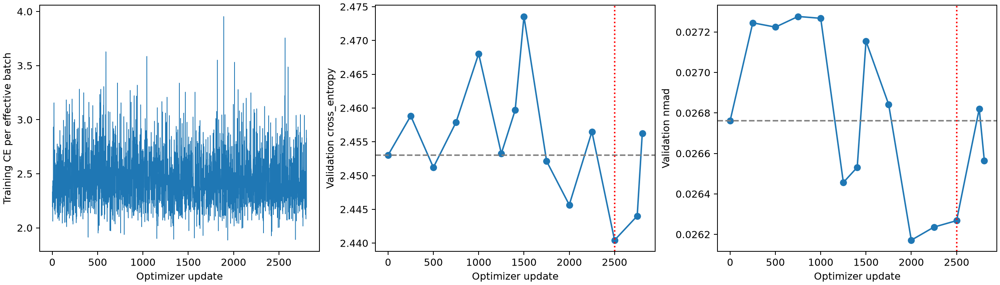
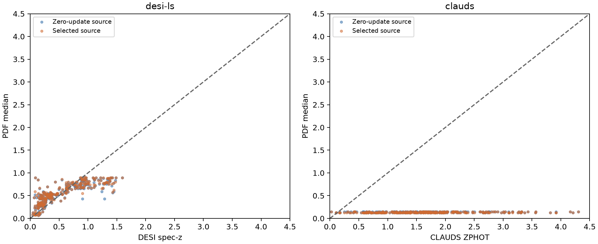

# Experiment A — warm-start Level-0 continued SFT

Status: **complete**. Updated 2026-10-24T00:50:56.615529+00:00.

Both the archived trained HSC QLoRA adapter and its matching trained PDF head are restored. Inputs use the original Level-0 serializer, full 22,444/5,683 source train/validation cohorts and the original 300-bin 0–4.5 grid. Test objects do not enter training or checkpoint selection.

Protocol: maximum 2 additional epochs, no head-only warmup, adapter LR 3e-06, head LR 1e-05, effective batch 16, seed 1023, source validation every 250 updates plus epoch ends. Learning rates are constant. AdamW moments are newly initialized; adapter/head weights are warm-started. Epoch-final partial batches use their actual sample count. These choices are recorded in `matched_protocol.json` for identical reuse by Experiments B/C.

Zero-update replay: passed on 5,683 validation objects; max logit difference 0, max PDF difference 0.

Completed optimizer updates: 2,806/2,806. Best source-CE candidate so far: update 2,500. Update zero is included.

| Source validation | CE | NMAD | Outliers | Bias | CRPS | 68% coverage |
|---|---:|---:|---:|---:|---:|---:|
| Zero updates | 2.453027 | 0.026762 | 1.073% | 0.000700 | 0.027404 | 73.025% |
| Best selected so far | 2.440432 | 0.026268 | 1.073% | 0.001061 | 0.027190 | 73.500% |
| Latest validation | 2.456254 | 0.026565 | 0.985% | 0.005288 | 0.026792 | 70.878% |

Training/periodic-validation wall time so far: 16.594 hours. Peak allocated GPU memory: 5.452 GiB.

## Fixed-weight transfer after source checkpoint selection

The selected source model and archived baseline use identical audited target validation queries. Legacy labels are DESI spec-z; CLAUDS labels are ZPHOT. No target labels are fitted or used for checkpoint selection.

| Target / model | CE | NMAD | Outliers | Bias | CRPS | 68% coverage |
|---|---:|---:|---:|---:|---:|---:|
| clauds: Zero-update source | 19.492022 | 0.134513 | 96.484% | -0.519838 | 1.489546 | 1.562% |
| clauds: Selected source | 20.045021 | 0.135879 | 96.484% | -0.521222 | 1.492119 | 1.562% |
| desi-ls: Zero-update source | 5.151609 | 0.153725 | 32.422% | 0.023918 | 0.154725 | 31.250% |
| desi-ls: Selected source | 5.059905 | 0.144464 | 32.812% | 0.029038 | 0.152464 | 31.250% |

## Answer

The selected checkpoint is update 2500. Relative to zero updates, source CE changes by -0.012595, NMAD by -0.000494, and CRPS by -0.000214. Selection guarantees only non-increasing validation CE because the initial checkpoint is a candidate; the latest-training row above shows whether continued optimisation itself degraded performance.

Changes in other metrics and target performance must be read separately. This unchanged-input control cannot establish any benefit from filter metadata. Source validation also selects the checkpoint, so these are validation/model-selection results rather than independent test confirmation.

Parameter changes for both selected and last-trained states are recorded in `parameter_changes.json`. The final summary records total run wall time including restoration, replay and transfer; the table above reports the training/periodic-validation portion.

## Additional evaluation GPUs

Training uses `MIG-a9b1fb4a-5c28-5b03-9686-f831c6facf25`. Validation and selected-model transfer inference are split over `MIG-bef01423-2506-5edb-a289-80c60b1f0297,MIG-412ff209-a29c-5bc8-9aa2-fd1a41474aec` using two independent frozen replicas, with synchronized adapter/head weights and the original batch-of-eight grouping and object order. Training, effective batch 16, optimizer, RNG, source selection and independent original-checkpoint initialization are unchanged. A → B → C executes sequentially. This accelerates evaluation, not optimizer updates. `evaluation_acceleration.json` records per-evaluation timings and both workers' peak allocated memory; the original training memory figure covers the training GPU only. `execution_backend.json` records code and devices.
