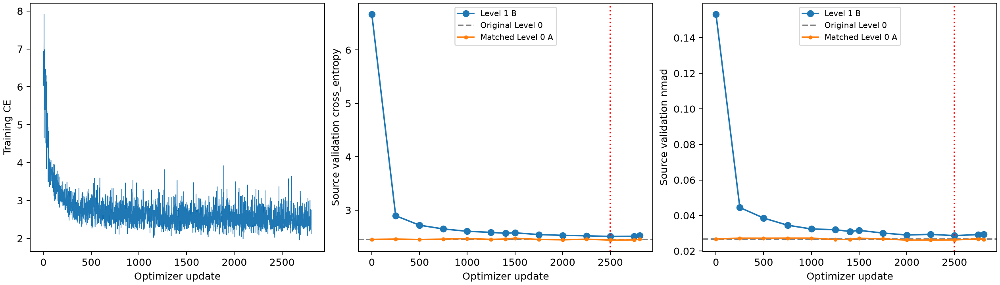
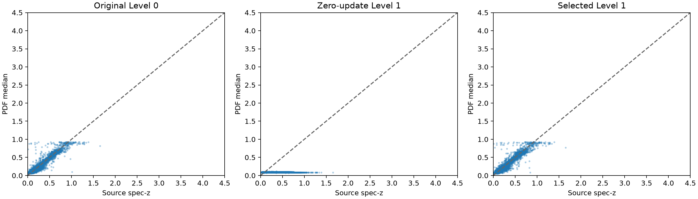
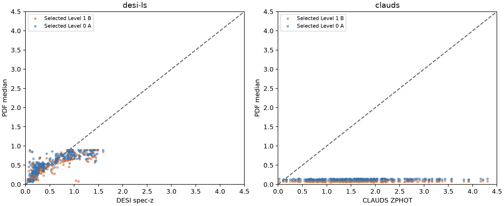

# Experiment B — warm-start Level-1 band-aware QLoRA

Status: **complete**. Updated 2026-10-25T19:39:27.689137+00:00.

The run starts from the original completed HSC adapter and trained PDF head, independently of A's continued weights. Restoration of both components is verified tensor by tensor when GPU execution starts. The exact same 22,444 training and 5,683 validation objects, native values/errors/masks, five-decimal formatting and 300-bin 0–4.5 PDF grid are retained. Only the serializer changes to explicit survey and physical-band identities. No wavelengths or widths are added.

Training matches A: at most two epochs / 2,806 updates, no head-only warmup, adapter LR 3e-6, head LR 1e-5, effective batch 16, seed 1023, constant learning rates, new AdamW moments, same rank/modules/weight decay/clipping. Source-validation CE selects among update zero and validations every 250 updates plus epoch ends. Test objects are excluded. Target labels enter inference metrics only.

Actual tokenizer audit: 28,127 source texts, maximum 174 / 512 tokens, zero truncations. Exact strings and token examples are saved. Target token audits are in the manifest.

## Serializer-only change and source adaptation

The two zero-update rows use identical original trained weights and the full identical source-validation cohort. Their difference isolates the input-format change.

| Model / evaluation | CE | NMAD | Outliers | Bias | CRPS | 68% coverage |
|---|---:|---:|---:|---:|---:|---:|
| Original weights / Level 0 | 2.453027 | 0.026762 | 1.073% | 0.000700 | 0.027404 | 73.025% |
| Original weights / Level 1 | 6.668456 | 0.153247 | 47.369% | -0.157844 | 0.220149 | 18.916% |
| Selected Level 1 / update 2500 | 2.507556 | 0.028672 | 1.056% | -0.000350 | 0.029106 | 72.462% |
| Latest Level-1 validation | 2.528105 | 0.029468 | 1.161% | 0.004221 | 0.028974 | 69.893% |
| Matched Level 0 A / update 2500 | 2.440432 | 0.026268 | 1.073% | 0.001061 | 0.027190 | 73.500% |

Serializer-only delta CE: +4.215429; delta NMAD: +0.126485. Changes are measured rather than presumed to be damage. A separate 32-object canonical Level-0 replay verifies restoration before this diagnostic.

Completed 2,806/2,806 optimizer updates. Best candidate: update 2500; elapsed training/periodic-validation time 14.35 hours.

## Fixed-weight cross-survey transfer

Identical audited 256-object validation queries per target. Legacy uses DESI spectroscopic redshifts and RELEASE-specific DECam or BASS/MzLS grz plus WISE W1/W2. CLAUDS uses ZPHOT and its actual MegaCam u/u_star, HSC grizy and VIRCAM YJHKs bands. Native CLAUDS imputed AB magnitudes and unavailable errors/EBV remain unchanged. There is no target fitting, calibration or target-based selection.

| Model / evaluation | CE | NMAD | Outliers | Bias | CRPS | 68% coverage |
|---|---:|---:|---:|---:|---:|---:|
| clauds / selected Level 1 B | 13.372568 | 0.124395 | 97.266% | -0.542130 | 1.530952 | 0.781% |
| clauds / selected Level 0 A | 20.045021 | 0.135879 | 96.484% | -0.521222 | 1.492119 | 1.562% |
| desi-ls / selected Level 1 B | 4.865762 | 0.123267 | 23.438% | -0.012408 | 0.143337 | 28.906% |
| desi-ls / selected Level 0 A | 5.059905 | 0.144464 | 32.812% | 0.029038 | 0.152464 | 31.250% |

## Findings and limits

Continued Level-1 adaptation changes CE by -4.160900 and NMAD by -0.124574 relative to the serializer-only starting point. Relative to the original Level-0 capability, selected Level-1 CE changes by +0.054529 and NMAD by +0.001911.

Best-CE selection guarantees only non-increasing CE relative to the Level-1 starting point; it does not guarantee retention of original Level-0 performance. Update zero can remain selected. Latest validation and last/selected parameter changes are retained to reveal failed adaptation. Source validation also selects the model, so these are model-selection results, not independent test confirmation. Improved transfer would support the utility of this representation under this protocol, not prove an internal understanding of band identity.

Relative to matched selected Level-0 A (B minus A): clauds: delta CE -6.672453, delta NMAD -0.011485, delta outliers +0.781%; desi-ls: delta CE -0.194143, delta NMAD -0.021197, delta outliers -9.375%. Negative CE/NMAD/outlier differences favor B; assess coverage and bias separately. These fixed query sets do not establish statistical significance or a general advantage across seeds.

## Additional evaluation GPUs

Training uses `MIG-1bba1f26-8b2b-5b97-9bb1-c886ab9bb8b7`. Validation and selected-model transfer inference are split over `MIG-0a2e21a6-8961-56b1-9eb4-997ae914386e,MIG-6c85a6c1-35aa-5ff1-ae36-a468e3e230b6` using two independent frozen replicas, with synchronized adapter/head weights and the original batch-of-eight grouping and object order. Training, effective batch 16, optimizer, RNG, source selection and independent original-checkpoint initialization are unchanged. A → B → C executes sequentially. This accelerates evaluation, not optimizer updates. `evaluation_acceleration.json` records per-evaluation timings and both workers' peak allocated memory; the original training memory figure covers the training GPU only. `execution_backend.json` records code and devices.
