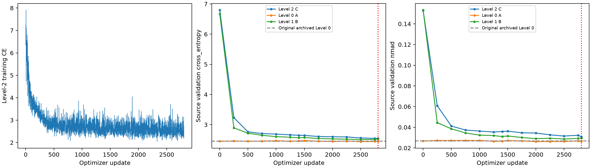
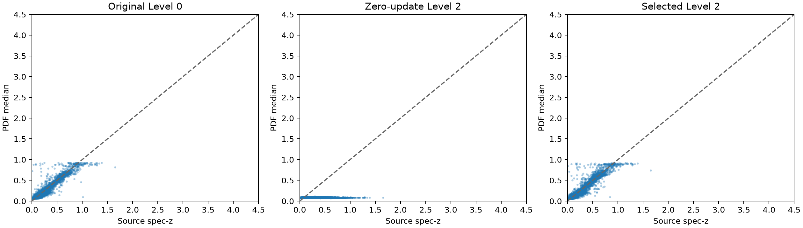
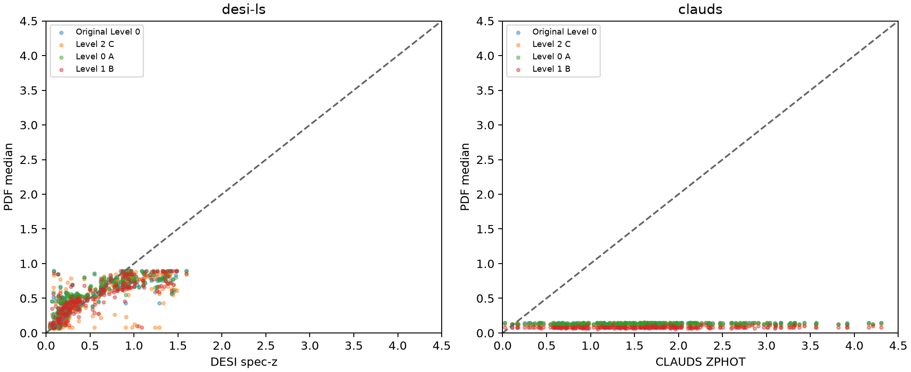

# Experiment C — warm-start Level-2 filter physics

Status: **complete**. Updated 2026-10-26T12:57:53.300871+00:00.

C is an independent branch from the original archived HSC Qwen3.5-4B-Base rank-8 QLoRA adapter and matching trained 256-hidden-unit PDF head. Both components are verified tensor by tensor when GPU execution begins. It uses the same 22,444 training and 5,683 validation objects, labels, numerical formatting, missingness and 300-bin 0–4.5 grid as A/B. Removing only `pivot_nm` and `width_nm` from every source and target string reproduces B byte for byte.

Protocol matches A/B: at most two additional epochs / 2,806 updates; no head-only warmup; adapter LR 3e-6; head LR 1e-5; effective batch 16; seed 1023; unchanged trainable modules, new AdamW moments, constant LRs, clipping and weight decay. Source-validation CE selects among update zero and validations every 250 updates plus epoch ends. No held-out test evaluation or target-label fitting/calibration/selection.

Actual tokenizer audit: source maximum 272 tokens; Legacy 276; CLAUDS 462. All inputs fit the common 512-token limit without truncation.

## Filter metadata and approximations

Pinned response profiles and original-file hashes are verified. Pivot wavelength is sqrt(∫Rλ dλ / ∫R/λ dλ); rectangular equivalent bandwidth is ∫R dλ / max(R), not FWHM. Both are in nm, serialized to three decimal places. R is the supplied relative photon-counting system response; no extra wavelength factor, SED weights, learned filter embeddings, full transmission curves or additional descriptors enter the prompts. The integrals are reproduced from the vendored profiles in `registry_audit.json`.

Source HSC grizy uses nominal HSC 2017 profiles. Exposure mixtures of r/r2 and i/i2 are unavailable in the feature cache, so r and i remain representative approximations; no per-object mixture is invented. Legacy RELEASE 9010/9012 uses representative DECam DR1 grz responses, 9011 uses BASS gr and MzLS z, and all use WISE W1/W2. CLAUDS uses MegaCam u/u_star (MP9302/MP9301), HSC grizy and VIRCAM YJHKs. These nominal curves are not object-specific throughputs. Other registry approximations are preserved in `registry_audit.json` and `filter_registry_snapshot.json`.

## Source serializer change and recovery

| Model / evaluation | CE | NMAD | Outliers | Bias | CRPS | 68% coverage |
|---|---:|---:|---:|---:|---:|---:|
| Original archived weights / Level 0 | 2.453027 | 0.026762 | 1.073% | 0.000700 | 0.027404 | 73.025% |
| Original archived weights / Level 2 | 6.795675 | 0.152845 | 47.545% | -0.158619 | 0.221691 | 17.720% |
| Original archived weights / Level 1 | 6.668456 | 0.153247 | 47.369% | -0.157844 | 0.220149 | 18.916% |
| Selected Level 0 A / update 2500 | 2.440432 | 0.026268 | 1.073% | 0.001061 | 0.027190 | 73.500% |
| Selected Level 1 B / update 2500 | 2.507556 | 0.028672 | 1.056% | -0.000350 | 0.029106 | 72.462% |
| Selected Level 2 C / update 2806 | 2.547055 | 0.030846 | 1.355% | 0.001889 | 0.030307 | 71.248% |
| Latest Level-2 validation | 2.547055 | 0.030846 | 1.355% | 0.001889 | 0.030307 | 71.248% |

The zero-update rows use identical original weights and objects; their differences measure serializer-only changes. Recovery through SFT is measured separately. A 32-object canonical Level-0 replay checks restoration before the full 5,683-object Level-2 diagnostic.

Training: 2,806/2,806 updates; selected update 2,806; training/periodic-validation wall time 17.185 hours; peak allocated GPU memory 5.452 GiB.

## Fixed-weight transfer and matched controls

All models use exactly the same audited 256 Legacy and 256 CLAUDS validation objects. Legacy reference: DESI spectroscopic redshift. CLAUDS reference: ZPHOT, not spectroscopy. Existing native CLAUDS imputed AB magnitudes, missing errors/EBV and five-decimal formatting are unchanged.

| Model / evaluation | CE | NMAD | Outliers | Bias | CRPS | 68% coverage |
|---|---:|---:|---:|---:|---:|---:|
| clauds / original archived Level 0 | 19.492022 | 0.134513 | 96.484% | -0.519838 | 1.489546 | 1.562% |
| clauds / selected Level 0 A | 20.045021 | 0.135879 | 96.484% | -0.521222 | 1.492119 | 1.562% |
| clauds / selected Level 1 B | 13.372568 | 0.124395 | 97.266% | -0.542130 | 1.530952 | 0.781% |
| clauds / selected Level 2 C | 18.473541 | 0.130129 | 96.484% | -0.523640 | 1.497649 | 1.172% |
| desi-ls / original archived Level 0 | 5.151609 | 0.153725 | 32.422% | 0.023918 | 0.154725 | 31.250% |
| desi-ls / selected Level 0 A | 5.059905 | 0.144464 | 32.812% | 0.029038 | 0.152464 | 31.250% |
| desi-ls / selected Level 1 B | 4.865762 | 0.123267 | 23.438% | -0.012408 | 0.143337 | 28.906% |
| desi-ls / selected Level 2 C | 4.273280 | 0.100839 | 26.562% | -0.023918 | 0.146732 | 46.484% |

## Findings

Level-2 adaptation changes source CE by -4.248619 and NMAD by -0.121999 relative to its zero-update Level-2 starting point. Relative to the original archived Level-0 capability, selected CE changes by +0.094028, NMAD by +0.004085, and outlier fraction by +0.282%.

Selected Level 2 remains numerically worse than the original source model in cross_entropy, nmad, catastrophic_outlier_fraction. Source quality has not uniformly recovered; target differences cannot provide a clean isolated test of filter-physics transfer.

Critical comparison, clauds, C minus B: CE +5.100973; NMAD +0.005734; outliers -0.781%; bias +0.018490; CRPS -0.033303; coverage +0.391%. Negative CE/NMAD/outlier/CRPS differences favor C; bias and coverage require separate interpretation.

Critical comparison, desi-ls, C minus B: CE -0.592482; NMAD -0.022428; outliers +3.125%; bias -0.011510; CRPS +0.003395; coverage +17.578%. Negative CE/NMAD/outlier/CRPS differences favor C; bias and coverage require separate interpretation.

Total GPU-run wall time: 17.304 hours (queue wait excluded; interruptions included if resumed). Peak allocated memory: 5.452 GiB. GPU UUID and memory at reservation are recorded in `gpu.json`; timing definition is in `timing.json`.

| Arm | Selected / trained updates | Training + validation hours | Total run hours | Peak allocated GiB |
|---|---:|---:|---:|---:|
| Level 2 C | 2806 / 2806 | 17.185 | 17.304 | 5.452 |
| Level 0 A | 2500 / 2806 | 16.594 | 16.782 | 5.452 |
| Level 1 B | 2500 / 2806 | 14.350 | 42.806 | 5.452 |

## Interpretation limits

The critical comparison is C versus B, since B already supplies explicit band identities. Source validation also selects checkpoints, so these are model-selection results. Retaining the zero-update candidate guarantees non-increasing CE only relative to Level 2, not the original Level 0; latest validation and last/selected parameter changes are saved. Single-seed point estimates on fixed 256-object target samples do not establish statistical significance.

Every HSC training galaxy uses essentially the same fixed filter set: wavelength and bandwidth do not vary independently across source objects. Successful source adaptation therefore does not demonstrate learning a physically transferable response dependence. Any transfer improvement is preliminary; multiple training filter systems and shuffled or incorrect metadata controls would be needed. This experiment does not demonstrate universal filter-aware generalisation.

## Additional evaluation GPUs

Training uses `MIG-1bba1f26-8b2b-5b97-9bb1-c886ab9bb8b7`. Validation and selected-model transfer inference are split over `MIG-0a2e21a6-8961-56b1-9eb4-997ae914386e,MIG-6c85a6c1-35aa-5ff1-ae36-a468e3e230b6` using two independent frozen replicas, with synchronized adapter/head weights and the original batch-of-eight grouping and object order. Training, effective batch 16, optimizer, RNG, source selection and independent original-checkpoint initialization are unchanged. A → B → C executes sequentially. This accelerates evaluation, not optimizer updates. `evaluation_acceleration.json` records per-evaluation timings and both workers' peak allocated memory; the original training memory figure covers the training GPU only. `execution_backend.json` records code and devices.
