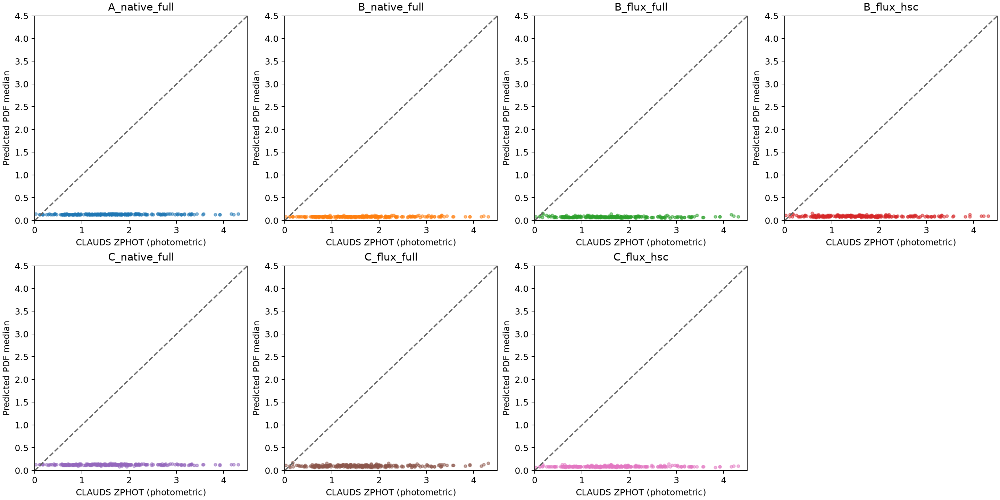
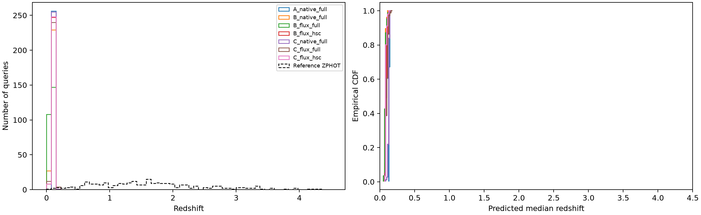
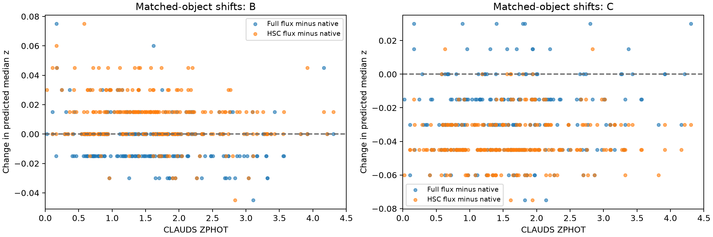
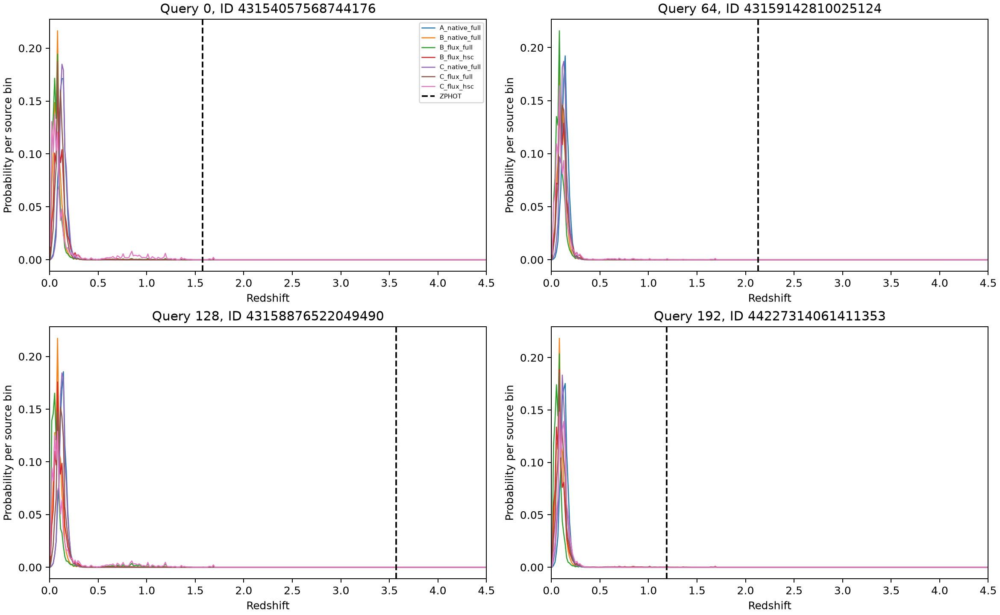

# CLAUDS common-flux interface: completed fixed-weight diagnostic

**Answer: numerical harmonisation did not rescue CLAUDS transfer.** On the same 256 audited validation galaxies, both selected HSC-source models still produce severely collapsed low-redshift predictions with 96.875–97.266% catastrophic outliers under common-flux inputs. Restricting to the actual HSC grizy bands does not resolve the failure. This is a result for these checkpoints, interfaces and queries, not a model-capacity limit.

## Protocol and integrity

The seven conditions below were fixed before inference. Selected updates are A=2500, B=2500, C=2806, chosen previously using source validation only. Every condition uses the identical ordered 256 CLAUDS IDs, original overlap exclusions (1 arcsec; nearest retained source separation 6.962 arcsec), and unchanged 300-bin redshift grid 0–4.5. References are **CLAUDS ZPHOT**, not spectroscopy. Original validation membership was verified against the original seeded split; only the 256 query labels were read from the raw catalogue. No held-out test was evaluated.

All parameters were frozen, with no optimizer, training, calibration, target-label fitting or target-based model/input selection. SHA-256 checks of the selected adapters, heads, selected-state files and protected archived results passed before and after inference. Base-model file sizes and modification times matched the training manifests. Native A/B/C replay on all 256 objects gave **zero maximum logit and PDF differences** from their respective archives. The A comparison row reuses its archived result.

## Conversion audit and corrections

The catalogue publication specifies AB photometry and **microJy** for every hscPipe `FLUX_CMODEL`/`FLUXERR_CMODEL` band, including VIRCAM (Table E.2). Its hscPipe/Phosphoros flux treatment is uncorrected for Galactic extinction (section 4.1); the separate SExtractor correction statement is not applicable here. The local FITS header has no definitive per-column unit or cmodel extinction-history annotation, so this identification rests on the matching catalogue provenance and schema. [Desprez et al. (2023)](https://arxiv.org/pdf/2301.13750)

The existing loader constructs historical native magnitudes as `23 - 2.5 log10(raw_flux)`. Those AB-labelled values are consequently 0.9 mag brighter than the physical microJy AB convention `23.9 - 2.5 log10(raw_flux)`. The old optional flux helper also assumed zero point 23. **The native serializer and all archived native strings were preserved.** Only the optional common-flux conversion was corrected:

```text
m_AB = 23.9 - 2.5 log10(f_microJy)
f_nMgy = 10**((22.5 - m_AB)/2.5)
       = f_microJy * 10**((22.5 - 23.9)/2.5)
       = 0.2754228703 * f_microJy
sigma_nMgy = 0.2754228703 * measured_sigma_microJy
```

The former scale was 0.6309573445, an overestimate by a factor 2.29087. No Vega-to-AB offset is applied to the NIR flux columns. For positive measurements, the flux transform agrees with the specified magnitude formula. Direct linear error scaling agrees with the first-order magnitude Jacobian `sigma_f = f ln(10)/2.5 sigma_m`; missing errors are not manufactured. No extra Phosphoros uncertainty rescaling or error floor is introduced.

230/256 queries have at least one originally missing/imputed magnitude. The flux interface never exponentiates those imputed entries. It reads raw cmodel flux/error columns, preserves finite signed/zero measurements, and uses `NA` for non-finite/-99 fluxes or measurements flagged `notObserved`/`isNoData`. Non-finite or nonpositive uncertainties become `sigma=NA`. The original masks and `hasBadPhotometry`/`isClean` flags are retained in the sidecar; no new quality cut is imposed. No finite non-sentinel measurement in these queries was additionally excluded by the two availability flags. 5/256 galaxies have no usable flux in any supported band; they remain in the fixed cohort.

No new extinction correction, EBV value, zero-point fitting, imputation, object selection or label information enters the strings. Target `EBV=NA` is retained; source training used its as-catalogued HSC magnitudes transformed to nanomaggies and supplied source MW_EBV. The missing target EBV and incompletely documented local extinction history remain limitations, not quantities inferred from ZPHOT.

This is **not a pure numerical ablation**: `unit` and `sigma_unit` change from `AB_mag` to `AB_nanomaggy`; `mag` becomes `flux`; real flux errors replace `sigma=NA` when available; unobserved imputed entries become explicitly missing, while real negative fluxes become usable observations. Survey, measurement tag, physical filter identities, band order, `extinction=as_loaded`, EBV convention and five-decimal formatting remain fixed. Level 2 retains the original pivot/equivalent-width metadata.

## Bands and tokenisation

Configuration I removes only non-HSC records, retaining the actual Subaru/HSC g,r,i,z,y identifiers and corresponding measurements in source order. Configuration II retains MegaCam u/u_star, HSC grizy and VIRCAM Y/J/H/Ks, with missing bands still explicit. No positional substitutions or invented photometry occur. HSC r/r2 and i/i2 exposure mixtures remain the original registry approximations.

HSC valid-band availability is {0: 6, 1: 3, 4: 10, 5: 237}; 237/256 have all five HSC bands. The per-band raw flux, uncertainty, mask and imputation counts are in [conversion_audit.json](conversion_audit.json). Actual strings, tokens and ordinary/missing examples are in [inputs/](inputs/).

43/256 full-band Level-2 flux records exceed the original 512-token limit; the maximum is 528. Before any new predictions, a single common limit `max(512, largest complete record)=528` was fixed for **every condition**. No observations were truncated. Native records fit below both limits and reproduced archived predictions exactly.

| Condition | Minimum tokens | Median | Maximum | Truncated |
|---|---:|---:|---:|---:|
| A_native_full | 140 | 140 | 140 | 0 |
| B_native_full | 243 | 243 | 243 | 0 |
| B_flux_full | 170 | 248 | 309 | 0 |
| B_flux_hsc | 92 | 152 | 157 | 0 |
| C_native_full | 462 | 462 | 462 | 0 |
| C_flux_full | 389 | 467 | 528 | 0 |
| C_flux_hsc | 190 | 250 | 255 | 0 |

## Comparison: all completed conditions

Bias values below are the mean/median of `(predicted PDF median - ZPHOT)/(1+ZPHOT)`. NMAD is `1.48 median(|delta - median(delta)|)`. Outliers have `|delta|>0.15`. CRPS and central 16th–84th percentile coverage use the original discrete PDF conventions. [comparison.csv](comparison.csv) is the single machine-readable table including every metric and distribution statistic.

| Condition | CE | NMAD | Outliers | Mean bias | Median bias | CRPS | 68% coverage |
|---|---:|---:|---:|---:|---:|---:|---:|
| A_native_full | 20.04502 | 0.13588 | 96.484% | -0.52122 | -0.56179 | 1.49212 | 1.562% |
| B_native_full | 13.37257 | 0.12439 | 97.266% | -0.54213 | -0.57965 | 1.53095 | 0.781% |
| B_flux_full | 11.80319 | 0.12693 | 97.266% | -0.54334 | -0.58247 | 1.50679 | 2.344% |
| B_flux_hsc | 11.37485 | 0.13448 | 97.266% | -0.53720 | -0.57329 | 1.47896 | 1.562% |
| C_native_full | 18.47354 | 0.13013 | 96.484% | -0.52364 | -0.56218 | 1.49765 | 1.172% |
| C_flux_full | 13.72308 | 0.13275 | 96.875% | -0.53491 | -0.57401 | 1.50513 | 1.953% |
| C_flux_hsc | 10.53045 | 0.13068 | 97.266% | -0.54044 | -0.57460 | 1.42635 | 4.297% |

## Prediction collapse and grid support

| Condition | Median predicted z | Predicted 5th–95th percentiles | Max fraction in any width-0.03 interval | Modal median-bin fraction | Unique median bins |
|---|---:|---|---:|---:|---:|
| A_native_full | 0.1275 | 0.1275–0.1425 | 100.00% | 66.80% | 2 |
| B_native_full | 0.0825 | 0.0675–0.0975 | 94.92% | 78.52% | 5 |
| B_flux_full | 0.0825 | 0.0675–0.1012 | 91.80% | 44.53% | 8 |
| B_flux_hsc | 0.0975 | 0.0825–0.1125 | 92.58% | 45.70% | 7 |
| C_native_full | 0.1275 | 0.1125–0.1425 | 97.27% | 62.11% | 6 |
| C_flux_full | 0.0975 | 0.0825–0.1275 | 81.25% | 33.59% | 8 |
| C_flux_hsc | 0.0825 | 0.0825–0.1125 | 94.53% | 76.56% | 6 |

The reference ZPHOT distribution has median 1.5747, 5th–95th percentiles 0.4250–3.3020, and range 0.0240–4.3061. All 256 references lie inside the source grid. For **every condition**, 100% of predicted medians also lie inside 0–4.5; that is enforced by the PDF support and does not establish correct redshifts. The low-z concentration measure uses a fixed interval width of two source bins (0.03) and no labels. Percentiles use linear interpolation.

The probability curves remain sharply concentrated near low redshift even for galaxies whose ZPHOT is much larger. Small NMAD differences describe the scatter of a biased, nearly constant predictor; they do not demonstrate useful recovery.

## Paired changes on identical galaxies

| New minus reference | Delta CE | Delta NMAD | Delta outliers (percentage points) | Median predicted-z shift | Outliers rescued / newly created |
|---|---:|---:|---:|---:|---:|
| B_flux_full minus A_native_full | -8.24184 | -0.00895 | +0.781 | -0.0600 | 0 / 2 |
| B_flux_full minus B_native_full | -1.56938 | +0.00254 | +0.000 | +0.0000 | 0 / 0 |
| B_flux_hsc minus B_flux_full | -0.42834 | +0.00755 | +0.000 | +0.0150 | 0 / 0 |
| C_flux_full minus B_flux_full | +1.91989 | +0.00582 | -0.391 | +0.0150 | 1 / 0 |
| C_flux_full minus C_native_full | -4.75046 | +0.00263 | +0.391 | -0.0300 | 0 / 1 |
| C_flux_hsc minus B_flux_hsc | -0.84440 | -0.00380 | +0.000 | +0.0000 | 0 / 0 |
| C_flux_hsc minus C_flux_full | -3.19263 | -0.00207 | +0.391 | -0.0150 | 0 / 1 |

Full per-object results are in [paired_predictions.csv](paired_predictions.csv), and all paired metric changes are in [paired_differences.json](paired_differences.json). No bootstrap interval is interpreted as independent validation.

## Interpretation, in the requested order

**A — Numerical compatibility.** No rescue. B stays at 249/256 outliers (97.266%) when changing native to full flux. C changes from 247/256 to 248/256 (96.875%). Neither full-flux intervention rescues a native outlier. CE drops by 1.56938 for B and 4.75046 for C, but the median predictions remain near 0.08–0.10 and 68% coverage remains only 1.95–2.34%. Better tail probabilities/CE do not remove the collapse.

**B — Physical band identity.** B common-flux differs from A native, but has no useful redshift recovery. This comparison cannot isolate the causal contribution of correct band labels: it changes selected adapter/head weights, serializer structure, units, error information and missingness together. A common-flux Level-0 model was not invented; Level 0 remains the specified archived control. There is no evidence here that band labelling alone fixes transfer.

**C — Filter metadata.** Under full flux, C has worse CE and NMAD than B (13.72308 vs 11.80319; 0.13275 vs 0.12693), with just one fewer outlier. Under HSC-only flux, C has lower CE/CRPS and higher coverage than B, but both have 249/256 outliers. Therefore a robust filter-metadata benefit for meaningful redshifts is not established. A/B/C also have different source-validation performance, so these are not perfectly isolated metadata effects.

**D — Band-set mismatch.** Removing all UV/NIR records does not fix either model: both HSC-only conditions have 97.266% outliers. Additional bands alter the PDF tails and medians but do not restore useful predictions. Full-band C is less concentrated by the width-0.03 measure, yet its predictions are still severely biased. Unseen-band presence is therefore not sufficient to explain the failure; additional photometry neither reliably helps nor uniquely causes collapse in this diagnostic.

**E — Remaining failure.** Physical microJy-to-nanomaggy scaling, measured uncertainties, explicit missingness, correct band labels, Level-2 summaries and restricting inputs to actual HSC bands all failed to resolve the observed collapse under the tested combinations. Unknown measurements/quality issues, missing target EBV, extinction-history uncertainty, flux/error distribution shift between HSC source and CLAUDS, and the difference between DESI spec-z supervision and CLAUDS ZPHOT are possible contributors. This experiment does not establish any one of them as the cause. Source-only adaptation on essentially one fixed filter system need not learn survey-independent use of metadata. No conclusion about intrinsic model capacity follows.

These are single-checkpoint, fixed-query diagnostic comparisons. The original object exclusions and source-only checkpoint selections are retained. None of the seven configurations was chosen as a winner using the target scores, and these results do not establish unseen-survey generalisation.

## Plots and reproducibility









PNG and PDF versions are available for all figures. PDF examples use predetermined query indices 0,64,128,192; the vertical dashed line is ZPHOT.

The [manifest](manifest.json) records the exact IDs, overlap audit, selected checkpoint identities, protected file hashes, code hashes, source grid, sequence rule, input hashes, GPU assignments and evaluation commands. Per-arm summaries record the actual GPU and command; [report_manifest.json](report_manifest.json) records this CPU report command and code. [commands.sh](commands.sh) contains the preparation/inference/collection commands; reproduce into a **new** output directory. Preparation, completed inference arms, collection and reporting refuse existing outputs.

**Validation:** 27 serializer/regression tests passed using `pixi run --locked python -m pytest -q tests/test_clauds_common_flux.py tests/test_filter_photometry.py`. Tests cover physical AB conversion, Jacobian agreement, signed/missing flux, absent errors, observation masks, no imputation leakage, label rejection, real HSC identities and byte-identical native strings. Native model replays independently passed on all 256 queries for A, B and C.

The optional microJy conversion fix changes the serializer module hash relative to historical training manifests. Original manifests and models are untouched; the new manifest records the corrected code, and native text/logit replay confirms that the archived native interface remains unchanged.
