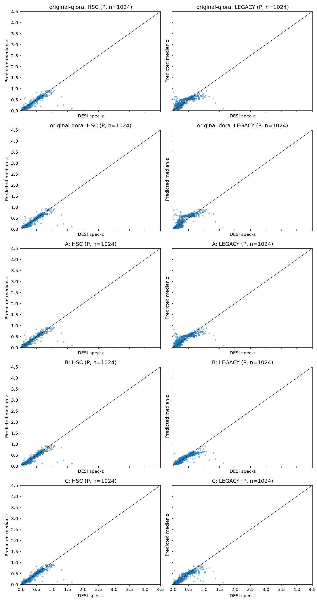
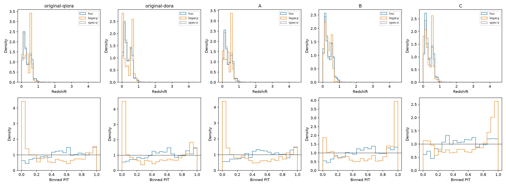
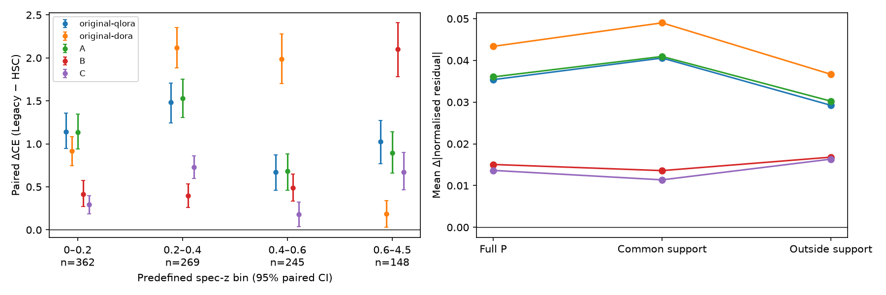
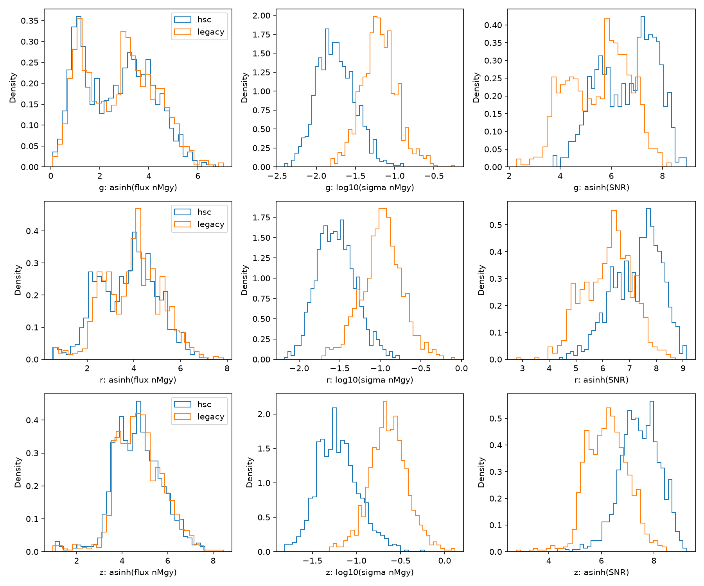

# Frozen same-galaxy HSC → Legacy benchmark

Five completed HSC-trained models were evaluated with both HSC and original Tractor observations of the **same galaxies**. No completed Legacy-trained adapter/head pair exists, so the reverse transfer cells are unavailable. No training, calibration or target-based checkpoint selection was performed.

On the independent selected P cohort, Legacy observations increase CE for **5/5 models**. For original QLoRA, NMAD changes from 0.0285 to 0.0671, and the catastrophic-outlier fraction from 1.37% to 8.30%. The comparisons below distinguish absolute predictive performance from the same-model observational transfer penalty.

## Cohort and independence

The complete raw audit found 134,533 HDF galaxies. The eligible paired pool contains **61,696 P**, **4,257 V**, and **16,600 T** objects. This execution evaluates **1,024 P** and **256 V** objects. P excludes training and validation exposure for every included model using TARGETID, HSC imaging identity and one-arcsecond spherical matches against HSC and DESI targeting coordinates. T is never scored. V is explicitly exploratory.

Selection: Ascending SHA256(1027:hsc_object_id); no z or predictions in sampling; n=0 means entire category. If a finite size limit was used, the numerical results describe that deterministic first-pass sample, **not every object in the eligible pool**. Whole-pool audit counts are provided separately. Every model/domain cell uses exactly the same selected IDs and labels.

Original HSC test objects were previously evaluated in completed training reports; now permitted for this predeclared frozen-model matched observation comparison, with no tuning or checkpoint selection. Not a never-inspected external sample.

P is independent of training and validation of the five completed HSC models only. Original held-out HSC test objects are allowed and explicitly flagged. Legacy incomplete models excluded; mutual HSC/Legacy-source independence not established.

### Sequential cuts

| Cut | Before | Removed | Remaining |
|---|---:|---:|---:|
| Exactly one original Tractor record per exact TARGETID | 134533 | 0 | 134533 |
| Unique primary DESI Iron spectrum passing original uniform galaxy quality and 0<=z<=4.5 | 134533 | 22531 | 112002 |
| Original Legacy survey restriction: main bright/dark (intersection of source protocols) | 112002 | 27277 | 84725 |
| Valid native HDF redshift and error | 84725 | 0 | 84725 |
| HDF/Iron label agreement to predeclared 1e-6 relative tolerance | 84725 | 2140 | 82585 |
| Original HSC minimum three valid bands | 82585 | 0 | 82585 |
| Original Legacy minimum three valid bands, with positive IVAR and NOBS | 82585 | 0 | 82585 |
| Verified DR9 filter provenance RELEASE in 9010/9011/9012 | 82585 | 0 | 82585 |
| Exact-ID pair positional verification within fixed one arcsecond | 82585 | 0 | 82585 |
| Unique HSC imaging identity across raw HDF rows | 82585 | 32 | 82553 |
| Unique Legacy imaging key among remaining pairs | 82553 | 0 | 82553 |
| Reject both members of ambiguous sub-arcsecond paired sky neighbours | 82553 | 0 | 82553 |

### Measurements and spectroscopy

HSC PDR2 cmodel AB magnitudes converted with original Jacobian; original DR9 Tractor signed fluxes, positive IVAR/NOBS; each uses its own EBV; no extra extinction correction. HDF fibermap targeting measurements were not assumed equivalent to the original Tractor VAC; the HDF also lacks NOBS. Native signed Legacy fluxes and all genuine missingness are retained. HSC i/y never occupy Legacy W1/W2 fields.

Spectroscopy uses the intersection of the archived source protocols: primary GALAXY/TGT, ZWARN=0, COADD_FIBERSTATUS=0, DELTACHI2>40, finite nonnegative ZERR, 0≤z≤4.5, main bright/dark. Label agreement was fixed at 1e−6×(1+|z_Iron|) before predictions. 41,965/84,725 checked labels are numerically identical; 82,585 pass the tighter agreement rule. All cells retain the same native HDF spectroscopic label. The HDF reduction tag is absent: numerical agreement does **not** establish identical DESI reductions.

The HDF lacks ZWARN, DELTACHI2, SPECTYPE, ZCAT_PRIMARY, SURVEY and PROGRAM. Its available OBJTYPE agrees for all 82,553 eligible pairs; its COADD_FIBERSTATUS differs for 400 pairs despite their DR1 Iron status passing the original source quality cut. These differences are preserved and reported, rather than claiming identical quality metadata. Selection uses the same Iron quality definition as the original source pipeline; no new HDF fiber-status cut was introduced. All 28,127 reconstructed HSC train/validation feature rows match the archived source arrays exactly. See `supplementary_audit.json` for quality flags, NOBS, MASKBITS and saved primary-provenance hashes.

## Frozen checkpoint inventory

| Model | Selected state | Source train / val / test | Native representation |
|---|---|---|---|
| original-qlora | epoch 9 (zero-based); minimum HSC val CE | 22444 / 5683 / 83853 | Level 0 |
| original-dora | epoch 9 (zero-based); minimum HSC val CE | 22444 / 5683 / 83853 | Level 0 |
| A | update 2500; minimum HSC val CE | 22444 / 5683 / 83853 | Level 0 |
| B | update 2500; minimum HSC val CE | 22444 / 5683 / 83853 | Level 1 |
| C | update 2806; minimum HSC val CE | 22444 / 5683 / 83853 | Level 2 |

All five source cohort membership sets agree; exact original QLoRA/DoRA validation/test IDs, matching preparation cache keys, and identical persisted A/B/C source arrays were verified. Exact ID lists are saved per model. Adapter/head paths, SHA256 hashes, configurations, selection rules and provenance are in `manifest.json`. Every adapter tensor was checked against its saved file, every source text replay checked against archived warm-start text, and a 32-object source-validation logit replay passed before paired inference. Checkpoint hashes were unchanged after inference.

## Matched transfer matrix: independent P

The point estimate is the median PDF-bin centre. CE is negative log probability **mass** in the spec-z bin. All grids were verified exactly equal: 300 equal-width bins over [0,4.5]. NMAD and median bias use the existing lower-median convention. CRPS and binned PIT use the existing evaluator; 68% coverage uses the bin-centre 16th–84th interval. These are frozen-checkpoint descriptive results.

| Model | n | HSC CE | Legacy CE | HSC NMAD | Legacy NMAD | HSC outliers | Legacy outliers |
|---|---:|---:|---:|---:|---:|---:|---:|
| original-qlora | 1024 | 2.5360 | 3.6385 | 0.0285 | 0.0671 | 1.37% | 8.30% |
| original-dora | 1024 | 2.5359 | 3.9187 | 0.0285 | 0.0842 | 1.37% | 10.84% |
| A | 1024 | 2.5277 | 3.6236 | 0.0273 | 0.0690 | 1.27% | 8.20% |
| B | 1024 | 2.5629 | 3.2341 | 0.0290 | 0.0499 | 1.17% | 2.34% |
| C | 1024 | 2.6039 | 3.0389 | 0.0312 | 0.0510 | 1.17% | 2.34% |
| Legacy QLoRA | — | unavailable | unavailable | — | — | — | — |
| Legacy DoRA | — | unavailable | unavailable | — | — | — | — |

### Paired transfer penalties (Legacy minus HSC)

| Model | ΔCE [95% CI] | ΔNMAD | Δoutlier fraction | Mean Δabs residual | Newly outlier / recovered |
|---|---|---:|---:|---:|---:|
| original-qlora | 1.1025 [0.9908, 1.2196] | 0.0386 | +6.93% | 0.0354 | 77 / 6 |
| original-dora | 1.3828 [1.2628, 1.5040] | 0.0557 | +9.47% | 0.0434 | 105 / 8 |
| A | 1.0960 [0.9830, 1.2104] | 0.0417 | +6.93% | 0.0361 | 77 / 6 |
| B | 0.6713 [0.5783, 0.7637] | 0.0210 | +1.17% | 0.0151 | 18 / 6 |
| C | 0.4350 [0.3620, 0.5042] | 0.0199 | +1.17% | 0.0136 | 17 / 5 |

1000 paired galaxy bootstrap draws, percentile 95%; conditional on these checkpoints; excludes training-seed uncertainty. All source, target and delta metric intervals, biases, CRPS, coverage, PIT, outlier transition counts and per-galaxy residual changes are in `results.json` and `*_paired_differences.csv`. The same paired bootstrap indices are used in every within-model contrast and all four cells of a cross-model penalty contrast.

## A/B/C and adaptation comparisons

| Penalty contrast | ΔΔCE [95% CI] | ΔΔNMAD [95% CI] |
|---|---|---|
| B_minus_A | -0.4247 [-0.5338, -0.3211] | -0.0207 [-0.0273, -0.0142] |
| C_minus_B | -0.2363 [-0.3161, -0.1546] | -0.0011 [-0.0063, 0.0028] |
| original-dora_minus_original-qlora | 0.2803 [0.1953, 0.3709] | 0.0170 [0.0071, 0.0220] |

Positive values indicate the second model has a larger observational transfer penalty. Absolute HSC and Legacy scores must also be considered: a smaller penalty can arise from worse in-domain predictions. C had worse archived HSC validation performance than B. These matched comparisons cannot establish that wavelength metadata were interpreted physically.

## Redshift dependence

Bins were fixed before inference from the spectroscopic distribution: {'initial_edges': [0.0, 0.2, 0.4, 0.6, 1.0, 2.0, 4.5], 'initial_counts': [362, 269, 245, 140, 8, 0], 'edges': [0.0, 0.2, 0.4, 0.6, 4.5], 'counts': [362, 269, 245, 148], 'minimum': 40, 'merge_rule': 'Accumulate adjacent bins left-to-right until >=40; merge final small tail backward', 'standardization': 'Equal weight for each nonempty merged spec-z bin; macro-average within-bin metrics, including NMAD (not pooled weighted NMAD)'}. All bins retain the same objects in both input conditions. Standardized results equally weight the merged nonempty bins, rather than changing the galaxy selection. Macro-averaged within-bin NMAD is explicitly not a pooled NMAD.

| Model | Spec-z range | n | HSC NMAD | Legacy NMAD | HSC outlier | Legacy outlier | ΔCE [95% CI] |
|---|---|---:|---:|---:|---:|---:|---|
| original-qlora | 0–0.2 | 362 | 0.0278 | 0.0796 | 1.38% | 13.26% | 1.1424 [0.9450, 1.3583] |
| original-qlora | 0.2–0.4 | 269 | 0.0313 | 0.0776 | 0.37% | 8.55% | 1.4817 [1.2461, 1.7096] |
| original-qlora | 0.4–0.6 | 245 | 0.0183 | 0.0402 | 1.22% | 0.00% | 0.6741 [0.4622, 0.8742] |
| original-qlora | 0.6–4.5 | 148 | 0.0322 | 0.0588 | 3.38% | 9.46% | 1.0248 [0.7704, 1.2751] |
| original-dora | 0–0.2 | 362 | 0.0286 | 0.0473 | 1.38% | 6.35% | 0.9152 [0.7462, 1.0824] |
| original-dora | 0.2–0.4 | 269 | 0.0313 | 0.1678 | 0.37% | 28.62% | 2.1171 [1.8856, 2.3544] |
| original-dora | 0.4–0.6 | 245 | 0.0172 | 0.0475 | 1.22% | 2.04% | 1.9900 [1.7011, 2.2791] |
| original-dora | 0.6–4.5 | 148 | 0.0321 | 0.0490 | 3.38% | 4.05% | 0.1865 [0.0297, 0.3373] |
| A | 0–0.2 | 362 | 0.0275 | 0.0826 | 1.38% | 14.09% | 1.1341 [0.9409, 1.3453] |
| A | 0.2–0.4 | 269 | 0.0285 | 0.0771 | 0.00% | 8.92% | 1.5312 [1.3096, 1.7542] |
| A | 0.4–0.6 | 245 | 0.0179 | 0.0391 | 1.22% | 0.00% | 0.6829 [0.4625, 0.8853] |
| A | 0.6–4.5 | 148 | 0.0357 | 0.0562 | 3.38% | 6.08% | 0.8955 [0.6600, 1.1427] |
| B | 0–0.2 | 362 | 0.0283 | 0.0397 | 0.83% | 0.55% | 0.4136 [0.2717, 0.5766] |
| B | 0.2–0.4 | 269 | 0.0309 | 0.0503 | 0.74% | 0.37% | 0.3967 [0.2607, 0.5374] |
| B | 0.4–0.6 | 245 | 0.0194 | 0.0348 | 0.82% | 0.41% | 0.4894 [0.3366, 0.6495] |
| B | 0.6–4.5 | 148 | 0.0347 | 0.0428 | 3.38% | 13.51% | 2.1016 [1.7808, 2.4080] |
| C | 0–0.2 | 362 | 0.0300 | 0.0420 | 0.28% | 0.83% | 0.2916 [0.1875, 0.3964] |
| C | 0.2–0.4 | 269 | 0.0322 | 0.0740 | 0.74% | 1.49% | 0.7298 [0.5993, 0.8602] |
| C | 0.4–0.6 | 245 | 0.0241 | 0.0353 | 1.22% | 0.00% | 0.1808 [0.0344, 0.3208] |
| C | 0.6–4.5 | 148 | 0.0440 | 0.0571 | 4.05% | 11.49% | 0.6704 [0.4662, 0.8995] |

| Model | Equal-bin HSC CE | Equal-bin Legacy CE | Equal-bin ΔCE [95% CI] |
|---|---:|---:|---|
| original-qlora | 2.6251 | 3.7059 | 1.0808 [0.9649, 1.1895] |
| original-dora | 2.6239 | 3.9261 | 1.3022 [1.1961, 1.4165] |
| A | 2.6164 | 3.6773 | 1.0609 [0.9494, 1.1673] |
| B | 2.6589 | 3.5092 | 0.8503 [0.7378, 0.9535] |
| C | 2.7020 | 3.1701 | 0.4682 [0.3902, 0.5474] |

Per-bin bias, median bias, CRPS, coverage and all transfer deltas are saved in `results.json`. This is redshift-stratified transfer, not strict high-z extrapolation: the source training includes these redshifts.

## Photometric support

Both HSC and Legacy must have valid common g/r/z and all 11 transformed coordinates within HSC training marginal 0.5–99.5 percentiles. HSC source training photometry only; no target labels. The transform uses source-only median g/r/z flux errors as asinh softening scales, log errors, asinh SNRs, and two asinh colours. It accepts signed target fluxes and requires genuine common-band errors. No target redshift enters the estimator.

| Model | P subset | n | ΔCE | Mean Δabs residual | Legacy outlier fraction |
|---|---|---:|---:|---:|---:|
| original-qlora | full | 1024 | 1.1025 | 0.0354 | 8.30% |
| original-qlora | support | 556 | 1.3183 | 0.0406 | 9.53% |
| original-qlora | outside_support | 468 | 0.8462 | 0.0292 | 6.84% |
| original-dora | full | 1024 | 1.3828 | 0.0434 | 10.84% |
| original-dora | support | 556 | 1.5534 | 0.0490 | 14.75% |
| original-dora | outside_support | 468 | 1.1801 | 0.0367 | 6.20% |
| A | full | 1024 | 1.0960 | 0.0361 | 8.20% |
| A | support | 556 | 1.3259 | 0.0410 | 9.53% |
| A | outside_support | 468 | 0.8228 | 0.0302 | 6.62% |
| B | full | 1024 | 0.6713 | 0.0151 | 2.34% |
| B | support | 556 | 0.6386 | 0.0136 | 1.62% |
| B | outside_support | 468 | 0.7100 | 0.0168 | 3.21% |
| C | full | 1024 | 0.4350 | 0.0136 | 2.34% |
| C | support | 556 | 0.3791 | 0.0114 | 1.98% |
| C | outside_support | 468 | 0.5013 | 0.0163 | 2.78% |

The full selected P sample remains the main reference. `photometric_distributions.json` provides source-training, full-eligible-pool and evaluated-P flux, error, signed SNR, positive-flux AB magnitude, nominal 5σ depth, g−r/r−z colour, missingness-pattern and EBV distributions. Colours/magnitudes are undefined for nonpositive fluxes; those measurements remain valid for inference. The support subset is a diagnostic fixed independently of target labels; it is a conservative marginal-box rule and does not establish equality of filter transmission, depth, calibration, or measurement pipelines. A paired observation comparison controls the evaluated physical galaxies and spec-z distribution, but does not causally isolate bandpass effects.

## Validation-exposed exploratory cohort

| Model | n | HSC CE | Legacy CE | ΔCE |
|---|---:|---:|---:|---:|
| original-qlora | 256 | 2.4896 | 3.5642 | 1.0746 |
| original-dora | 256 | 2.4929 | 3.8670 | 1.3742 |
| A | 256 | 2.4728 | 3.5449 | 1.0721 |
| B | 256 | 2.5289 | 3.1627 | 0.6338 |
| C | 256 | 2.5685 | 2.9343 | 0.3658 |

V is not independent evidence because its HSC labels were used in checkpoint selection. Its full stratified/support results are separately tagged in `results.json`.

## Figures









## Reproduction and remaining bidirectional gap

Persistent outputs: `/arc/projects/ots/Cosmic_Imprint_of_Time/filter_aware_checkpoints/1027/hsc-legacy-paired`. The compact report is mirrored under `reports/filter-aware/1027/hsc-legacy-paired/`. `audit.json` contains raw fingerprints, filtering counts, numerical label comparisons, per-band HDF/Tractor comparison, RELEASE counts and all per-model membership counts. `eligible_pairs.npz` preserves the full audited pool; `cohort.npz` preserves exact evaluated IDs, both measurement matrices, masks, labels and exposure. `inputs/` stores every exact serialized record. `evaluation_policy.json` was written before predictions and its hash was verified by every worker. `manifest.json` contains exact checkpoints, hashes and compatible PDF grids. Prediction chunks are atomic and resumable.

```bash
PIXI_CACHE_DIR=/scratch/.tmp-gsm/pixi-cache pixi run --locked python notebooks/audit_hsc_legacy_pairing.py --output-dir filter-aware-runs/1027/hsc-legacy-paired/raw-audit
PIXI_CACHE_DIR=/scratch/.tmp-gsm/pixi-cache pixi run --locked python notebooks/hsc_legacy_paired_benchmark.py prepare --output-dir filter-aware-runs/1027/hsc-legacy-paired --n-primary 1024 --n-validation 256
# For each of original-qlora original-dora A B C, select one actually idle MIG slice:
CUDA_VISIBLE_DEVICES=<idle-MIG-UUID> PIXI_CACHE_DIR=/scratch/.tmp-gsm/pixi-cache pixi run --locked python notebooks/hsc_legacy_paired_benchmark.py run --output-dir filter-aware-runs/1027/hsc-legacy-paired --model <model>
PIXI_CACHE_DIR=/scratch/.tmp-gsm/pixi-cache pixi run --locked python notebooks/audit_hsc_legacy_measurements.py --output-dir filter-aware-runs/1027/hsc-legacy-paired
PIXI_CACHE_DIR=/scratch/.tmp-gsm/pixi-cache pixi run --locked python notebooks/hsc_legacy_paired_benchmark.py report --output-dir filter-aware-runs/1027/hsc-legacy-paired
```

Do not rerun prepare over an existing manifest. Frozen inference reuses verified completed chunks. The original Legacy runs currently have no completed adapter/head; their removed sampled-cohort cache prevents reconstructing exact source exposure from preparation metadata alone. To complete a mutually independent bidirectional benchmark: (1) recover or deterministically reconstruct the original Legacy sampled cohort and train/val/test IDs using the archived preparation code/configuration and raw input order, verifying the saved cache key and split counts; (2) obtain genuinely completed compatible Legacy-trained adapter/head states selected solely on source validation (or separately authorize any future training); (3) repeat identifier/group/position exposure OR across both source cohorts, freeze the mutually clean P intersection and the evaluation policy, then evaluate all four cells on exactly those IDs. If that intersection is too small, reserve a genuinely new matched catalogue outside both source exposure sets before any new training. No training was launched here.
