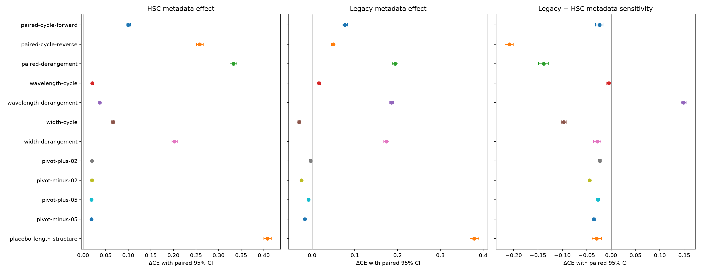
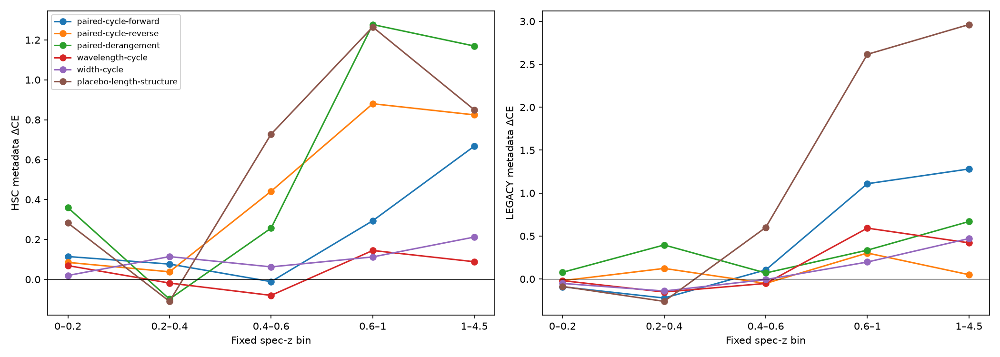
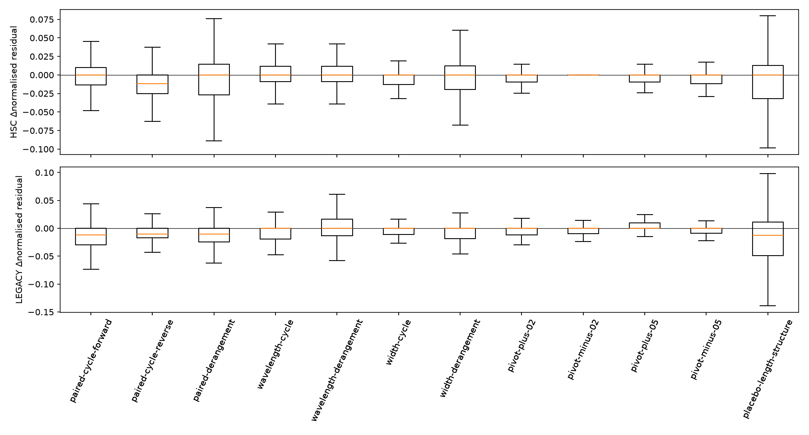
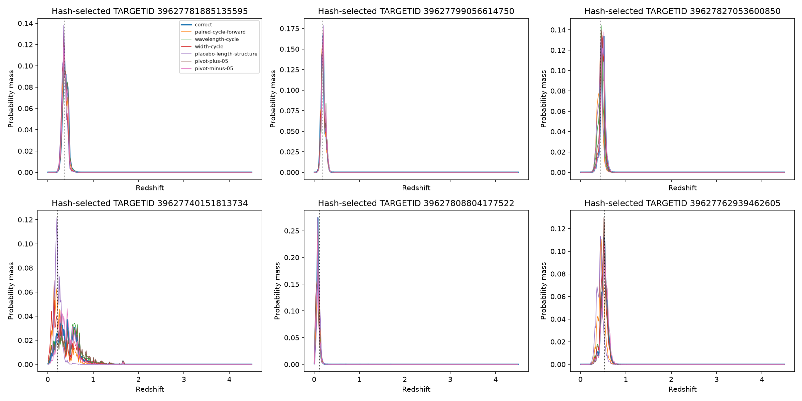
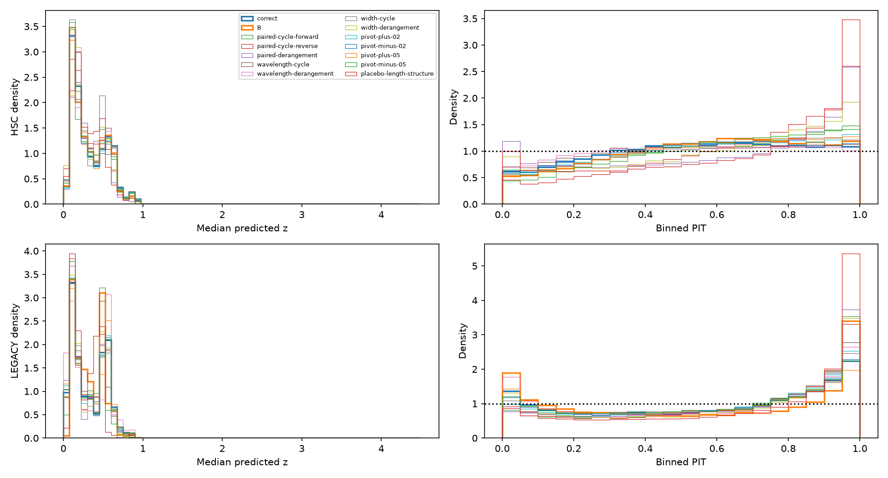

# Frozen filter-metadata counterfactuals

Completed all **13 predetermined C conditions**, each on both observations of the identical **61,696 independent paired galaxies**. B is an external frozen Level-1 reference. All weights and PDF heads were unchanged. Both original B/C full-cohort metrics and every live baseline logit/PDF were reproduced exactly before full counterfactual inference.

## Established findings

Across the 12 incorrect assignments, the CE outcome counts are `{'hsc': {'conditions': 12, 'incorrect_worse_CE': 12, 'incorrect_worse_CE_ci_excludes_zero': 12, 'incorrect_better_CE_ci_excludes_zero': 0}, 'legacy': {'conditions': 12, 'incorrect_worse_CE': 7, 'incorrect_worse_CE_ci_excludes_zero': 7, 'incorrect_better_CE_ci_excludes_zero': 5}}`. The complete table below is reported; no perturbations were selected using target errors.

| Condition | HSC CE | Legacy CE | HSC NMAD | Legacy NMAD | HSC outlier | Legacy outlier |
|---|---:|---:|---:|---:|---:|---:|
| B (different frozen weights) | 2.5245 | 3.1430 | 0.0285 | 0.0483 | 1.15% | 2.00% |
| correct | 2.5672 | 3.0065 | 0.0304 | 0.0475 | 1.25% | 2.06% |
| paired-cycle-forward | 2.6675 | 3.0831 | 0.0336 | 0.0464 | 1.50% | 2.87% |
| paired-cycle-reverse | 2.8256 | 3.0565 | 0.0356 | 0.0473 | 1.93% | 2.36% |
| paired-derangement | 2.8999 | 3.2009 | 0.0423 | 0.0519 | 2.24% | 3.48% |
| wavelength-cycle | 2.5876 | 3.0225 | 0.0319 | 0.0466 | 1.17% | 2.45% |
| wavelength-derangement | 2.6043 | 3.1926 | 0.0329 | 0.0552 | 1.30% | 2.52% |
| width-cycle | 2.6342 | 2.9764 | 0.0323 | 0.0458 | 1.49% | 2.15% |
| width-derangement | 2.7698 | 3.1805 | 0.0369 | 0.0510 | 1.85% | 3.02% |
| pivot-plus-02 | 2.5868 | 3.0031 | 0.0312 | 0.0469 | 1.26% | 2.04% |
| pivot-minus-02 | 2.5869 | 2.9821 | 0.0315 | 0.0464 | 1.23% | 1.91% |
| pivot-plus-05 | 2.5856 | 2.9980 | 0.0315 | 0.0477 | 1.24% | 1.93% |
| pivot-minus-05 | 2.5857 | 2.9897 | 0.0309 | 0.0467 | 1.28% | 1.99% |
| placebo-length-structure | 2.9755 | 3.3854 | 0.0441 | 0.0561 | 2.28% | 5.98% |

## Paired metadata effects

All Δ values below change only numerical pivot/width fields in the same C checkpoint. ΔΔ is Legacy metadata sensitivity minus HSC metadata sensitivity when both domains are perturbed. For a target-only perturbation, the transfer-penalty change equals ΔLegacy; it is a separate design.

| Condition | ΔHSC CE [95% CI] | ΔLegacy CE [95% CI] | ΔΔCE [95% CI] | ΔLegacy CRPS [95% CI] |
|---|---|---|---|---|
| paired-cycle-forward | +0.1004 [+0.0953, +0.1056] | +0.0765 [+0.0702, +0.0829] | -0.0238 [-0.0316, -0.0163] | +0.0061 [+0.0058, +0.0064] |
| paired-cycle-reverse | +0.2585 [+0.2511, +0.2663] | +0.0499 [+0.0459, +0.0537] | -0.2085 [-0.2173, -0.2006] | +0.0031 [+0.0029, +0.0033] |
| paired-derangement | +0.3327 [+0.3253, +0.3406] | +0.1943 [+0.1880, +0.2011] | -0.1384 [-0.1487, -0.1284] | +0.0096 [+0.0092, +0.0099] |
| wavelength-cycle | +0.0204 [+0.0178, +0.0230] | +0.0159 [+0.0119, +0.0200] | -0.0045 [-0.0091, -0.0001] | +0.0021 [+0.0019, +0.0023] |
| wavelength-derangement | +0.0371 [+0.0346, +0.0397] | +0.1861 [+0.1817, +0.1905] | +0.1490 [+0.1438, +0.1539] | +0.0052 [+0.0051, +0.0054] |
| width-cycle | +0.0670 [+0.0633, +0.0705] | -0.0302 [-0.0334, -0.0270] | -0.0972 [-0.1020, -0.0921] | +0.0001 [-0.0001, +0.0002] |
| width-derangement | +0.2026 [+0.1969, +0.2089] | +0.1740 [+0.1680, +0.1800] | -0.0287 [-0.0358, -0.0209] | +0.0067 [+0.0065, +0.0070] |
| pivot-plus-02 | +0.0196 [+0.0179, +0.0213] | -0.0034 [-0.0058, -0.0009] | -0.0230 [-0.0258, -0.0202] | +0.0006 [+0.0005, +0.0007] |
| pivot-minus-02 | +0.0197 [+0.0181, +0.0214] | -0.0244 [-0.0264, -0.0224] | -0.0442 [-0.0467, -0.0416] | -0.0006 [-0.0007, -0.0005] |
| pivot-plus-05 | +0.0184 [+0.0166, +0.0205] | -0.0085 [-0.0109, -0.0058] | -0.0270 [-0.0303, -0.0238] | -0.0009 [-0.0010, -0.0008] |
| pivot-minus-05 | +0.0185 [+0.0162, +0.0210] | -0.0169 [-0.0188, -0.0147] | -0.0354 [-0.0384, -0.0324] | -0.0005 [-0.0006, -0.0004] |
| placebo-length-structure | +0.4083 [+0.4002, +0.4170] | +0.3789 [+0.3690, +0.3898] | -0.0295 [-0.0388, -0.0196] | +0.0210 [+0.0205, +0.0216] |

1000 fixed, saved paired galaxy bootstrap index arrays shared across all conditions and domains; conditional on these checkpoints and population; no training-seed uncertainty. Bootstrap indices are saved and hashed before inference. Per-bin CE/CRPS intervals use the same draws restricted to that bin. All biases, coverage, PIT, paired residual changes and newly catastrophic/rescued counts are retained in `results.json` and per-object NPZs.

## Interpretation: H1–H4

H1 (ignored metadata): the observed ranges are `{'hsc': {'mean_total_variation_range': [0.06310980021953583, 0.2979336082935333], 'median_changed_fraction_range': [0.41211747925311204, 0.851076244813278]}, 'legacy': {'mean_total_variation_range': [0.06790732592344284, 0.32603490352630615], 'median_changed_fraction_range': [0.43203773340248963, 0.820555627593361]}}`. Nonzero PDF total variation demonstrates that metadata is not exactly ignored, even when the discretized median stays in the same bin. The size of the response and the corresponding CE/CRPS changes, rather than mere nonzero sensitivity, determine its practical importance.

H2 (numerical but nonphysical sensitivity): on Legacy, 5 of 12 incorrect assignments improve CE with paired intervals entirely below zero; 7 worsen it with intervals entirely above zero. Changed PDFs establish dependence on numerical tokens. Improved incorrect assignments or mixed directions weaken a uniform physical-correctness claim, while degradation alone cannot rule out learned nonphysical token associations.

H3 (correctness advantage): correct metadata has lower Legacy CE at the point estimate for 7 of 12 comparisons, and lower HSC CE for 12 of 12. Correctness is systematically advantageous across this entire predetermined set only if all comparisons support that direction. Even consistent superiority supports an inference-time association, not a learned physical response model: each HSC profile’s correct constants were effectively fixed throughout training.

H4 (structured local response): fixed ±2% and ±5% results are `{'hsc': {'fraction_nondecreasing': 0.007439704356846473, 'fraction_nonincreasing': 0.0046356327800829876, 'mean_shift': {'pivot-minus-05': -0.008353184908628464, 'pivot-minus-02': 8.015550702111796e-05, 'correct': 0.0, 'pivot-plus-02': -0.003262678161263466, 'pivot-plus-05': -0.004368631634861231}, 'interpretation': 'Fixed-checkpoint token-level finite perturbations, not a physically changed galaxy spectrum, physical derivative, or proof of spectral-feature reasoning'}, 'legacy': {'fraction_nondecreasing': 0.022529823651452282, 'fraction_nonincreasing': 0.005802645228215768, 'mean_shift': {'pivot-minus-05': -0.000452773500001058, 'pivot-minus-02': -0.002681066282093525, 'correct': 0.0, 'pivot-plus-02': -0.006666435860097408, 'pivot-plus-05': 0.005004956386983395}, 'interpretation': 'Fixed-checkpoint token-level finite perturbations, not a physically changed galaxy spectrum, physical derivative, or proof of spectral-feature reasoning'}}`. These are finite token interventions on unchanged photometry, not physically self-consistent altered observations. They do not establish redshifting of spectral features.

B versus C uses different adapted weights and measures the broader training/representation change. Correct C versus corrupted C isolates inference-time numerical sensitivity. A future matched-training intervention with correct versus shuffled metadata could address a different causal question; no such training was launched.

## Redshift stratification

Predeclared edges: `[0.0, 0.2, 0.4, 0.6, 1.0, 4.5]`. The bin above z=1 contains 400 objects, and no claim about z>2 generalisation is supported. All conditions use identical objects in each bin. B’s separate absolute per-bin metrics are retained in `B_reference.redshift_bins`; B/C differences are not called within-checkpoint metadata effects.

| Condition | Bin | n | HSC CE | Legacy CE | ΔHSC CE | ΔLegacy CE | ΔΔCE |
|---|---|---:|---:|---:|---:|---:|---:|
| correct | 0–0.2 | 23141 | 2.2974 | 2.6069 | +0.0000 | +0.0000 | +0.0000 |
| correct | 0.2–0.4 | 16094 | 2.6381 | 3.3932 | +0.0000 | +0.0000 | +0.0000 |
| correct | 0.4–0.6 | 14551 | 2.6062 | 2.7837 | +0.0000 | +0.0000 | +0.0000 |
| correct | 0.6–1 | 7510 | 2.9776 | 3.6192 | +0.0000 | +0.0000 | +0.0000 |
| correct | 1–4.5 | 400 | 6.1925 | 7.1716 | +0.0000 | +0.0000 | +0.0000 |
| paired-cycle-forward | 0–0.2 | 23141 | 2.4119 | 2.5162 | +0.1145 | -0.0907 | -0.2052 |
| paired-cycle-forward | 0.2–0.4 | 16094 | 2.7148 | 3.1720 | +0.0768 | -0.2212 | -0.2980 |
| paired-cycle-forward | 0.4–0.6 | 14551 | 2.5949 | 2.8894 | -0.0114 | +0.1057 | +0.1170 |
| paired-cycle-forward | 0.6–1 | 7510 | 3.2714 | 4.7286 | +0.2938 | +1.1095 | +0.8157 |
| paired-cycle-forward | 1–4.5 | 400 | 6.8600 | 8.4524 | +0.6675 | +1.2808 | +0.6134 |
| paired-cycle-reverse | 0–0.2 | 23141 | 2.3826 | 2.5875 | +0.0851 | -0.0195 | -0.1046 |
| paired-cycle-reverse | 0.2–0.4 | 16094 | 2.6761 | 3.5165 | +0.0380 | +0.1233 | +0.0853 |
| paired-cycle-reverse | 0.4–0.6 | 14551 | 3.0478 | 2.7325 | +0.4416 | -0.0512 | -0.4928 |
| paired-cycle-reverse | 0.6–1 | 7510 | 3.8576 | 3.9217 | +0.8800 | +0.3025 | -0.5775 |
| paired-cycle-reverse | 1–4.5 | 400 | 7.0168 | 7.2219 | +0.8243 | +0.0504 | -0.7739 |
| paired-derangement | 0–0.2 | 23141 | 2.6571 | 2.6847 | +0.3597 | +0.0777 | -0.2820 |
| paired-derangement | 0.2–0.4 | 16094 | 2.5394 | 3.7895 | -0.0987 | +0.3963 | +0.4950 |
| paired-derangement | 0.4–0.6 | 14551 | 2.8630 | 2.8540 | +0.2568 | +0.0703 | -0.1866 |
| paired-derangement | 0.6–1 | 7510 | 4.2544 | 3.9550 | +1.2768 | +0.3358 | -0.9410 |
| paired-derangement | 1–4.5 | 400 | 7.3617 | 7.8408 | +1.1692 | +0.6693 | -0.4999 |
| wavelength-cycle | 0–0.2 | 23141 | 2.3665 | 2.5880 | +0.0690 | -0.0190 | -0.0880 |
| wavelength-cycle | 0.2–0.4 | 16094 | 2.6197 | 3.2415 | -0.0184 | -0.1517 | -0.1334 |
| wavelength-cycle | 0.4–0.6 | 14551 | 2.5261 | 2.7321 | -0.0801 | -0.0516 | +0.0285 |
| wavelength-cycle | 0.6–1 | 7510 | 3.1225 | 4.2114 | +0.1449 | +0.5922 | +0.4473 |
| wavelength-cycle | 1–4.5 | 400 | 6.2810 | 7.5926 | +0.0885 | +0.4211 | +0.3326 |
| wavelength-derangement | 0–0.2 | 23141 | 2.3538 | 2.7658 | +0.0564 | +0.1589 | +0.1025 |
| wavelength-derangement | 0.2–0.4 | 16094 | 2.6924 | 3.7560 | +0.0543 | +0.3628 | +0.3085 |
| wavelength-derangement | 0.4–0.6 | 14551 | 2.5769 | 3.0367 | -0.0293 | +0.2530 | +0.2823 |
| wavelength-derangement | 0.6–1 | 7510 | 3.0492 | 3.4134 | +0.0716 | -0.2058 | -0.2774 |
| wavelength-derangement | 1–4.5 | 400 | 6.1898 | 6.7418 | -0.0027 | -0.4297 | -0.4270 |
| width-cycle | 0–0.2 | 23141 | 2.3171 | 2.5556 | +0.0197 | -0.0514 | -0.0710 |
| width-cycle | 0.2–0.4 | 16094 | 2.7522 | 3.2532 | +0.1141 | -0.1400 | -0.2541 |
| width-cycle | 0.4–0.6 | 14551 | 2.6690 | 2.7775 | +0.0628 | -0.0062 | -0.0690 |
| width-cycle | 0.6–1 | 7510 | 3.0901 | 3.8167 | +0.1125 | +0.1975 | +0.0850 |
| width-cycle | 1–4.5 | 400 | 6.4047 | 7.6425 | +0.2121 | +0.4709 | +0.2588 |
| width-derangement | 0–0.2 | 23141 | 2.5575 | 2.6773 | +0.2600 | +0.0703 | -0.1897 |
| width-derangement | 0.2–0.4 | 16094 | 2.6122 | 3.6776 | -0.0258 | +0.2844 | +0.3102 |
| width-derangement | 0.4–0.6 | 14551 | 2.7393 | 2.7827 | +0.1331 | -0.0010 | -0.1341 |
| width-derangement | 0.6–1 | 7510 | 3.5943 | 4.1440 | +0.6167 | +0.5249 | -0.0919 |
| width-derangement | 1–4.5 | 400 | 7.0227 | 8.6768 | +0.8301 | +1.5053 | +0.6752 |
| pivot-plus-02 | 0–0.2 | 23141 | 2.2814 | 2.5915 | -0.0161 | -0.0154 | +0.0007 |
| pivot-plus-02 | 0.2–0.4 | 16094 | 2.6731 | 3.3968 | +0.0351 | +0.0036 | -0.0314 |
| pivot-plus-02 | 0.4–0.6 | 14551 | 2.6607 | 2.7791 | +0.0545 | -0.0046 | -0.0591 |
| pivot-plus-02 | 0.6–1 | 7510 | 3.0095 | 3.6589 | +0.0319 | +0.0398 | +0.0079 |
| pivot-plus-02 | 1–4.5 | 400 | 6.1554 | 6.8118 | -0.0372 | -0.3598 | -0.3226 |
| pivot-minus-02 | 0–0.2 | 23141 | 2.3077 | 2.5754 | +0.0103 | -0.0315 | -0.0418 |
| pivot-minus-02 | 0.2–0.4 | 16094 | 2.6257 | 3.3538 | -0.0124 | -0.0394 | -0.0269 |
| pivot-minus-02 | 0.4–0.6 | 14551 | 2.6827 | 2.7819 | +0.0765 | -0.0018 | -0.0783 |
| pivot-minus-02 | 0.6–1 | 7510 | 2.9908 | 3.6117 | +0.0132 | -0.0074 | -0.0207 |
| pivot-minus-02 | 1–4.5 | 400 | 6.1092 | 7.0164 | -0.0834 | -0.1551 | -0.0718 |
| pivot-plus-05 | 0–0.2 | 23141 | 2.3171 | 2.6118 | +0.0196 | +0.0049 | -0.0147 |
| pivot-plus-05 | 0.2–0.4 | 16094 | 2.5999 | 3.3721 | -0.0382 | -0.0210 | +0.0172 |
| pivot-plus-05 | 0.4–0.6 | 14551 | 2.6555 | 2.8607 | +0.0493 | +0.0770 | +0.0277 |
| pivot-plus-05 | 0.6–1 | 7510 | 3.0533 | 3.4442 | +0.0757 | -0.1750 | -0.2507 |
| pivot-plus-05 | 1–4.5 | 400 | 6.2266 | 6.9076 | +0.0340 | -0.2639 | -0.2980 |
| pivot-minus-05 | 0–0.2 | 23141 | 2.2854 | 2.5768 | -0.0120 | -0.0301 | -0.0181 |
| pivot-minus-05 | 0.2–0.4 | 16094 | 2.6548 | 3.3687 | +0.0168 | -0.0244 | -0.0412 |
| pivot-minus-05 | 0.4–0.6 | 14551 | 2.6041 | 2.8022 | -0.0021 | +0.0185 | +0.0206 |
| pivot-minus-05 | 0.6–1 | 7510 | 3.1337 | 3.6014 | +0.1561 | -0.0178 | -0.1739 |
| pivot-minus-05 | 1–4.5 | 400 | 6.2168 | 6.9566 | +0.0243 | -0.2149 | -0.2392 |
| placebo-length-structure | 0–0.2 | 23141 | 2.5800 | 2.5206 | +0.2825 | -0.0863 | -0.3689 |
| placebo-length-structure | 0.2–0.4 | 16094 | 2.5278 | 3.1326 | -0.1102 | -0.2606 | -0.1503 |
| placebo-length-structure | 0.4–0.6 | 14551 | 3.3340 | 3.3842 | +0.7278 | +0.6005 | -0.1273 |
| placebo-length-structure | 0.6–1 | 7510 | 4.2422 | 6.2348 | +1.2646 | +2.6156 | +1.3509 |
| placebo-length-structure | 1–4.5 | 400 | 7.0421 | 10.1339 | +0.8496 | +2.9623 | +2.1127 |

## Input and token audit

The intervention wraps the original Level-2 serializer and changes only `pivot_nm` and `width_nm`, both to three decimal places in nm. Every original nonmetadata byte, filter identity, survey/instrument name, signed flux, uncertainty, missing value, EBV, object ordering and label is preserved. North/south Legacy optical profiles are distinct; shared WISE identities have one global mapping. Paired cycles and seeded derangements preserve the entire pair collection within each domain’s physical-profile group.

The common context limit is 512; no record is truncated. The numerical placebo independently permutes pivot/width assignments within HSC, Legacy optical, and WISE strata. Its observed exact-length fractions are `{'hsc': 1.0, 'legacy': 1.0}`. Equal lengths do not imply identical token IDs or equal attention. `tokenization_audit.json` records all token-length distributions, positionwise changed-ID frequencies and systematic length differences; `tokens/` preserves actual token IDs for every record.

## Figures











## Reproduction and preserved artifacts

Persistent output: `/arc/projects/ots/Cosmic_Imprint_of_Time/filter_aware_checkpoints/1027/metadata-counterfactual`. `manifest.json` records exact saved B/C checkpoint paths, SHA256 identities, the immutable original registry hash and original benchmark artifact hashes. Policy SHA256: `6ae49322e71e7b83e72763c1e7f129f76ee9c7f4e1250be8dbb7dffe6ac891f0`. All original artifacts were verified unchanged after analysis. Raw predictions, exact inputs/token IDs, per-object metrics, bootstrap arrays, replay proofs and code snapshots remain in project storage through the ignored `filter-aware-runs` link. Compact results and figures are mirrored in this report directory.

```bash
PIXI_CACHE_DIR=/scratch/.tmp-gsm/pixi-cache pixi run --locked python notebooks/filter_metadata_counterfactual.py prepare --output-dir /arc/projects/ots/Cosmic_Imprint_of_Time/filter_aware_checkpoints/1027/metadata-counterfactual
PIXI_CACHE_DIR=/scratch/.tmp-gsm/pixi-cache pixi run --locked python notebooks/supervise_filter_metadata_counterfactual.py --output-dir /arc/projects/ots/Cosmic_Imprint_of_Time/filter_aware_checkpoints/1027/metadata-counterfactual
PIXI_CACHE_DIR=/scratch/.tmp-gsm/pixi-cache pixi run --locked python notebooks/filter_metadata_counterfactual.py report --output-dir /arc/projects/ots/Cosmic_Imprint_of_Time/filter_aware_checkpoints/1027/metadata-counterfactual
```

Prepare requires a new directory; completed prediction chunks are reused on an interrupted inference restart. Stop/check an existing supervisor before resuming; the supervisor also holds an exclusive process lock. No target calibration, fitting, condition selection, unrelated test evaluation or SFT occurred.
