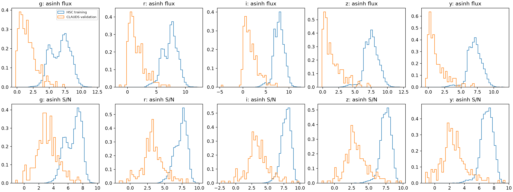
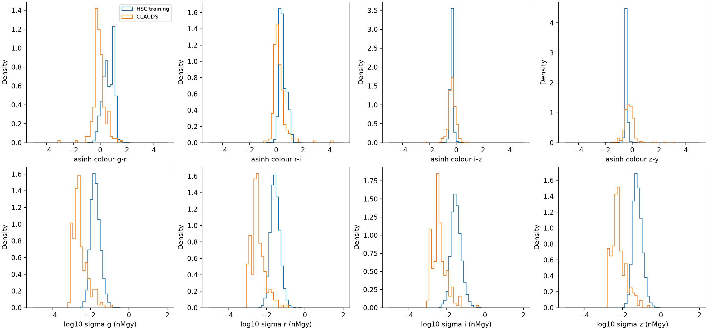
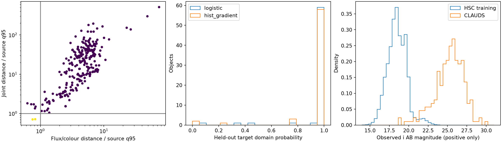
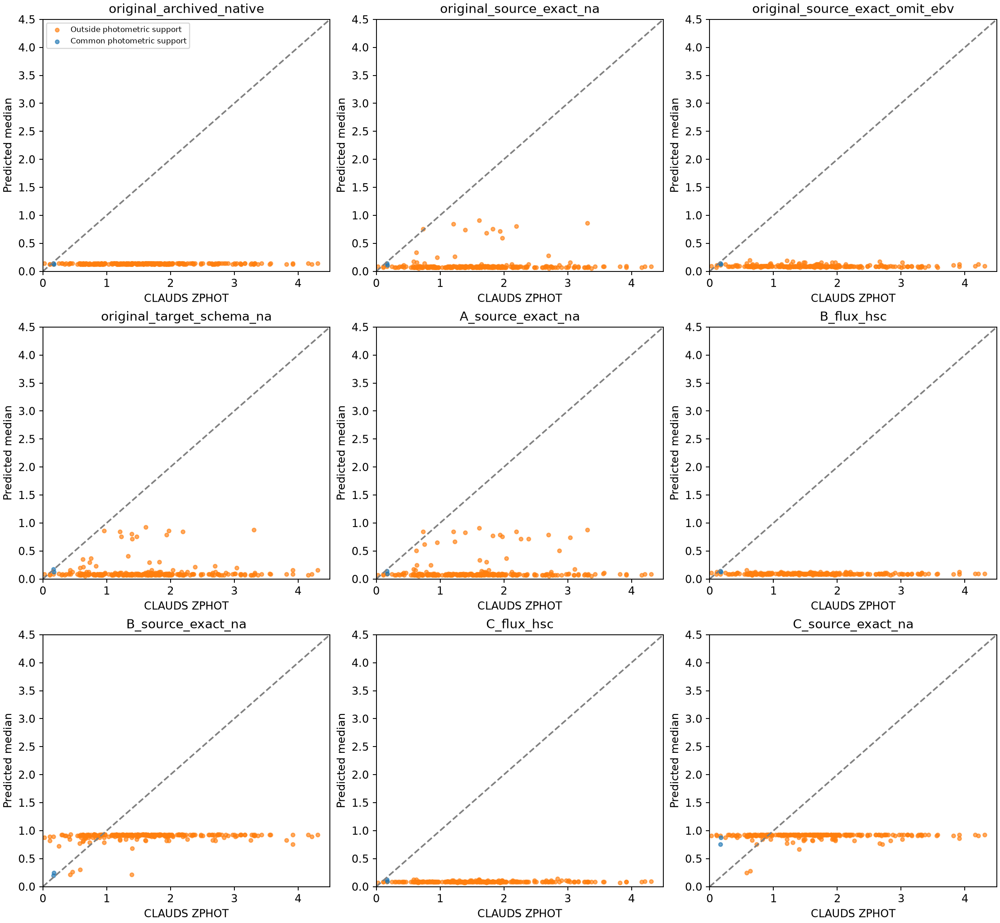
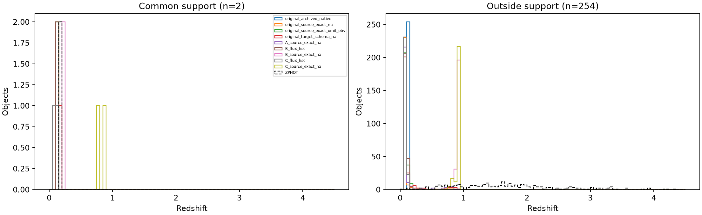
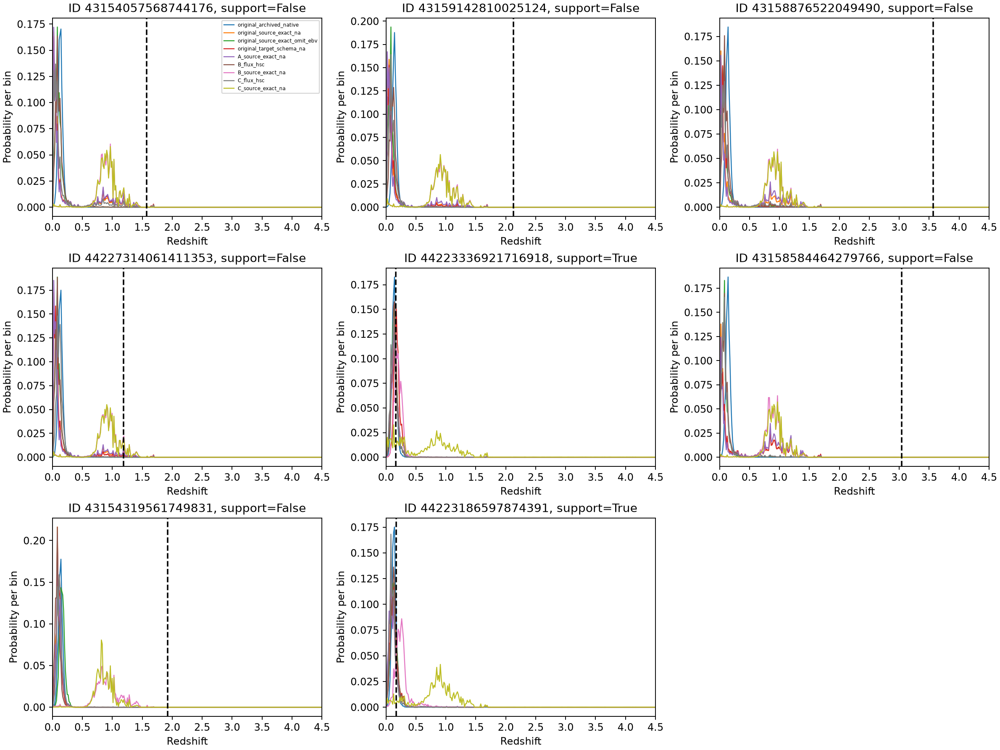

# Stage 0 — HSC to CLAUDS diagnostic

The corrected common physical units and exact source field format do not establish
successful transfer. The original frozen model with exact source fields and
explicit missing EBV has 96.88% outliers.
Only **2/256 (0.78%)** pass the prespecified joint photometric support
criterion. This cohort is overwhelmingly outside the bright, high-S/N source
training distribution. There is also direct evidence of input-interface
sensitivity: on unchanged source validation photometry, replacing EBV by NA
increases outliers from 5.47% to 43.75%. The target failure cannot be attributed
uniquely to population shift while this metadata/final-token effect remains.

## Protocol

All 256 IDs are the original overlap-audited CLAUDS **validation** queries, in
their original order. References are **ZPHOT, not spectroscopic redshifts**.
The original completed QLoRA adapter/PDF head and selected continued-SFT A/B/C
states (updates 2500/2500/2806) are frozen. No optimiser, redshift-model training,
target-label calibration or checkpoint selection is performed. Domain classifiers
are fitted solely to photometry and source/target membership. No held-out test
objects are evaluated. The source cohort used for support is 22,444 training and
5,683 validation objects; test membership/photometry is not loaded.

Source/target unit equivalence and catalogue-column checks are in
[input_audit.md](input_audit.md), [band_audit.csv](band_audit.csv), and
[serializer_comparison.json](serializer_comparison.json). The archived native
loader is untouched, including its historical 0.9-mag inconsistency.

## Photometric support

Features use signed asinh fluxes and adjacent asinh-colour differences. The joint
space additionally includes log absolute errors, asinh S/N, and smooth log
relative errors. Per-band softness is the source-training median error; robust
centres/IQR scales and missing-feature fills are fitted on source training only.
Missingness indicators accompany those fills. These analytical fills never enter
model strings. No logarithm of a nonpositive flux is taken. Error/colour/SN terms
are correlated; distance is an operational diagnostic, not a physical density.

Five source-training folds each use 80% as the neighbour reference and 20% for
calibration. The mean distance to k=10 neighbours is divided by that fold's
source-only 95th-percentile calibration distance. Median ratio across folds <=1
defines each pass; **common support requires complete grizy and both passes**.
Assignments were saved and hashed before new inference or reading evaluation
labels. The source validation pass rates are
95.50%
(flux/colour) and 95.51%
(joint). CLAUDS passes are 7/256 and 2/256, respectively. The main joint criterion
retains 2; this is a finite-sample, feature-dependent estimate, not literal zero
support elsewhere. Fold-0 sensitivity at source 90/95/99 percentiles retains
{'0.9': 3, '0.95': 7, '0.99': 26} in flux/colour and
{'0.9': 0, '0.95': 2, '0.99': 24} in joint space. These
descriptive sensitivities do not change the frozen main assignments.

Median positive-flux i magnitude is **25.51**
for CLAUDS versus **18.45** in source training.
Median i S/N is **13.8** versus **1351.8**.
237 objects have all five bands; missingness alone cannot explain the result.
109 have at least one HSC bad-photometry flag, with no quality filtering.
Brightness and S/N strata use source-training terciles, not target errors.
Completeness/quality strata and all conditional metrics are provided separately.

Two independent fixed domain classifiers use 128 target objects for fitting,
64 for validation, and a separate 64 held out from fitting/validation. Source
training objects have a separate 60/20/20 partition; their preprocessing is fitted
only on the source classifier-training partition. Balanced held-out comparisons
have 64 source and 64 target objects. Logistic AUC is
**0.9966**, bootstrap 95% interval
[0.9898891625615764, 1.0]; gradient boosting AUC is
**0.9985**, interval
[0.9948670239660229, 1.0].
No density ratios are inferred from these probabilities; near-perfect
classification does not prove literal zero support. Validation results,
partitions, parameters and probabilities are saved in domain_classifier.json
and domain_partition.npz.

## Fixed-weight serialization experiment

`source_exact_na` preserves source field names, units, order and precision with
`MW_EBV=NA`; `source_exact_omit_ebv` omits that unavailable field. Their source
schema identifier and PDR2 field names are explicitly counterfactual aliases.
`target_schema_na` changes only the embedded survey schema tag. No target
measurement or uncertainty is substituted. B/C source-format evaluations are
deliberate cross-schema stress tests, not their trained filter-aware format.

| Condition | N | CE | NMAD | Outliers | Bias | CRPS | 68% coverage | Predicted median |
|---|---:|---:|---:|---:|---:|---:|---:|---:|
| original_archived_native | 256 | 19.4920 | 0.1345 | 96.48% | -0.5198 | 1.4895 | 1.56% | 0.1425 |
| original_source_exact_na | 256 | 9.2894 | 0.1381 | 96.88% | -0.5321 | 1.2729 | 11.33% | 0.0825 |
| original_source_exact_omit_ebv | 256 | 11.8928 | 0.1315 | 97.27% | -0.5372 | 1.5018 | 1.95% | 0.0825 |
| original_target_schema_na | 256 | 9.7230 | 0.1450 | 96.88% | -0.5245 | 1.2821 | 8.98% | 0.0825 |
| A_native_full | 256 | 20.0450 | 0.1359 | 96.48% | -0.5212 | 1.4921 | 1.56% | 0.1275 |
| A_source_exact_na | 256 | 9.4559 | 0.1442 | 96.09% | -0.5237 | 1.2205 | 12.50% | 0.0825 |
| B_native_full | 256 | 13.3726 | 0.1244 | 97.27% | -0.5421 | 1.5310 | 0.78% | 0.0825 |
| B_flux_hsc | 256 | 11.3748 | 0.1345 | 97.27% | -0.5372 | 1.4790 | 1.56% | 0.0975 |
| B_source_exact_na | 256 | 9.7117 | 0.2190 | 73.83% | -0.2056 | 0.7680 | 14.45% | 0.9225 |
| C_native_full | 256 | 18.4735 | 0.1301 | 96.48% | -0.5236 | 1.4976 | 1.17% | 0.1275 |
| C_flux_hsc | 256 | 10.5304 | 0.1307 | 97.27% | -0.5404 | 1.4263 | 4.30% | 0.0825 |
| C_source_exact_na | 256 | 10.5388 | 0.2204 | 76.95% | -0.1967 | 0.7827 | 11.72% | 0.9225 |

The complete 20-condition table is performance_all.csv, including full-band
common-flux B/C results and every schema variant. NMAD is the archived
1.48*median absolute centred normalized residual; bias is mean normalized
residual; catastrophic outliers have |delta|>0.15. Metrics use the original
300-bin 0–4.5 PDF conventions. With n=2, NMAD can be zero under the archived
lower-median convention and is not evidence of precision. `conditional_performance.csv`
also records median bias, CRPS, coverage, prediction quantiles/std, modal-bin
fraction, concentration in a 0.03-wide interval, and source-distance ratios.

| Condition | Median z | 5–95% predicted medians | Maximum fraction in width 0.03 |
|---|---:|---:|---:|
| original_archived_native | 0.1425 | 0.1275–0.1425 | 100.00% |
| original_source_exact_na | 0.0825 | 0.0675–0.2512 | 88.67% |
| original_source_exact_omit_ebv | 0.0825 | 0.0675–0.1425 | 80.86% |
| original_target_schema_na | 0.0825 | 0.0675–0.3562 | 78.12% |
| A_native_full | 0.1275 | 0.1275–0.1425 | 100.00% |
| A_source_exact_na | 0.0825 | 0.0675–0.6788 | 83.59% |
| B_native_full | 0.0825 | 0.0675–0.0975 | 94.92% |
| B_flux_hsc | 0.0975 | 0.0825–0.1125 | 92.58% |
| B_source_exact_na | 0.9225 | 0.8138–0.9375 | 78.12% |
| C_native_full | 0.1275 | 0.1125–0.1425 | 97.27% |
| C_flux_hsc | 0.0825 | 0.0825–0.1125 | 94.53% |
| C_source_exact_na | 0.9225 | 0.8175–0.9225 | 87.11% |

The B/C source-format interventions mostly move the concentration to z~0.92;
they do not restore a broad object-sensitive prediction distribution. CE/coverage
and the outlier fraction must be interpreted alongside these concentration data.

## Common-support evaluation

| Condition | N | CE | NMAD | Outliers | Bias | CRPS | 68% coverage | Predicted median |
|---|---:|---:|---:|---:|---:|---:|---:|---:|
| original_archived_native | 2 | 2.4549 | 0.0000 | 0.00% | -0.0303 | 0.0289 | 50.00% | 0.1350 |
| B_flux_hsc | 2 | 2.4746 | 0.0000 | 0.00% | -0.0303 | 0.0285 | 100.00% | 0.1350 |
| C_flux_hsc | 2 | 2.9763 | 0.0000 | 0.00% | -0.0495 | 0.0416 | 50.00% | 0.1125 |
| original_source_exact_na | 2 | 2.8329 | 0.0000 | 0.00% | -0.0367 | 0.0354 | 50.00% | 0.1275 |
| original_source_exact_omit_ebv | 2 | 2.6027 | 0.0000 | 0.00% | -0.0303 | 0.0282 | 100.00% | 0.1350 |
| original_target_schema_na | 2 | 2.3964 | 0.0000 | 0.00% | -0.0174 | 0.0253 | 100.00% | 0.1500 |
| A_source_exact_na | 2 | 2.8530 | 0.0000 | 0.00% | -0.0431 | 0.0361 | 50.00% | 0.1200 |
| B_source_exact_na | 2 | 2.5365 | 0.0000 | 0.00% | +0.0465 | 0.0269 | 100.00% | 0.2250 |
| C_source_exact_na | 2 | 5.0271 | 0.0000 | 100.00% | +0.5526 | 0.3747 | 50.00% | 0.8175 |

The two common-support IDs are 44223186597874391, 44223336921716918.
This sample is too small for a general claim about conditional transfer. All
other objects remain in the out-of-support stratum; no object is removed on the
basis of its redshift error. Flux/colour-only support is more permissive and
should not be conflated with comparable measurement noise. Support matching
does not establish invariance of redshift conditional on photometry.
`support_sensitivity_performance.csv` evaluates the previously saved source-only
90/95/99-percentile sensitivity rules and the 7-object complete flux/colour
stratum. These are descriptive checks and do not replace the primary definition.
Within that 7-object flux/colour-only stratum, 5/7 are catastrophic outliers for
the original native/source-exact and B/C HSC common-flux conditions. Thus matching
flux/colour alone does not establish noise equivalence or conditional transfer.

## Source EBV/final-token control

A separate intervention uses the first 256 archived source validation objects,
the original frozen model, and unchanged source photometry. It was specified
before this control's inference; no target label determines its configuration.
These source references are the archived DESI spectroscopic redshifts, unlike
the target ZPHOT references.

| Condition | N | CE | NMAD | Outliers | Bias | CRPS | 68% coverage | Predicted median |
|---|---:|---:|---:|---:|---:|---:|---:|---:|
| source_native | 256 | 2.8384 | 0.0303 | 5.47% | +0.0043 | 0.0470 | 73.83% | 0.5025 |
| source_missing_ebv | 256 | 6.0565 | 0.1854 | 43.75% | -0.1411 | 0.2273 | 29.69% | 0.1725 |
| source_omit_ebv | 256 | 6.3643 | 0.1901 | 52.34% | -0.1834 | 0.2960 | 16.41% | 0.1425 |
| source_target_schema | 256 | 6.6805 | 0.1593 | 43.36% | -0.1438 | 0.2248 | 24.61% | 0.2025 |

The native control gives NMAD 0.0303, outliers 5.47%; changing only EBV
to NA gives NMAD 0.1854, outliers 43.75%; omission gives
NMAD 0.1901, outliers 52.34%. These control rows quantify sensitivity to
unavailable metadata and the changed last token. They do not supply missing
target EBV or justify inventing a target value.
The large degradation on source photometry establishes a genuine input-interface
failure mode. It does not identify whether the model uses astrophysical EBV,
the final numeric-token statistics, or both; the combined intervention changes
all of those. Omission is also harmful and therefore is not a remedy.

## Decisions A–E

**A. Numerical and semantic compatibility:** measured grizy fluxes can be put in
the same AB-nanomaggy units with audited errors and explicit missingness. The
native magnitude interface has a real historical 0.9-mag discrepancy. Filter
system compatibility is supported, but exact measurement-pipeline/extinction
equivalence is not established by the local metadata. Signed target measurements
must remain signed; source magnitude selection has already lost that information.

**B. Serialization:** the original checkpoint is not rescued. For B/C, exact
source fields with NA reduce outliers from ~97% to ~74–77%, but primarily shift
the concentrated mode from ~0.08–0.10 to ~0.92. Coverage remains ~12–14%, so this
is interface sensitivity rather than successful transfer. EBV
omission and schema-tag changes are separate diagnostics and cannot be chosen
as a production interface using these target labels. Last-token and metadata
sensitivity is assessed by the source control above.

**C. Meaningful photometric support:** the main operational estimate is
2/256 (0.78%), with 7/256 in the less restrictive flux/colour space.
The strong brightness, noise and domain separability shifts are directly
observed; exact support fractions depend on feature/threshold choices.

**D. Common-support failure:** both retained objects avoid catastrophic errors
under all archived native/common-flux conditions and the original source-exact
condition. B source-exact also has 0/2 outliers, while deliberately applying the
foreign source format to C gives 2/2; changing only B's survey schema gives 1/2.
Thus the dominant archived failure is concentrated outside the measured support.
These two galaxies cannot establish robust conditional invariance or success
across CLAUDS; their coverage still depends on the interface.

**E. Interpretation:** a severe photometric population/noise shift is measured,
and missing-EBV/final-token sensitivity independently degrades source performance.
Both contribute plausible failure mechanisms. Together with unresolved processing
differences, they prevent unique attribution to population shift versus learned
representation limitations. This experiment
does not measure all astrophysical knowledge in the foundation model.

**Stage 1/2:** the corrected optional raw-flux interface is physically consistent
for follow-on controlled diagnostics, provided provenance, units, signed fluxes,
real errors and missing metadata stay explicit. An unconditional claim of a
trustworthy cross-survey-equivalent interface is **not yet warranted**. Before
interpreting new training as generalisation, resolve or explicitly model the
extinction/calibration/pipeline history and EBV/final-token differences, and
evaluate adequate photometric overlap using validation-only protocols. No Stage
1/2 training was started by this task.

## Reproducibility and integrity

commands.sh records actual commands; reproduce.sh creates a fresh directory.
requirements-executed.txt records the isolated runtime. manifest.json contains
object IDs, catalogue row indices via hashed inputs, seed, source configuration,
checkpoint paths/updates, base-model size/mtime fingerprints and SHA-256 hashes
for protected adapters, heads, archives and prepared inputs. Protection checks
pass before/after all four inference arms and collection. Native replay maximum
logit differences are {'original': 0.0, 'A': 0.0, 'B': 0.0, 'C': 0.0};
maximum PDF differences are {'original': 0.0, 'A': 0.0, 'B': 0.0, 'C': 0.0}.
The source control has a separate replay and protocol. Artifact inventory records
final output hashes. Every example was chosen by fixed index/photometry/support,
not by redshift prediction error. The restored checkpoint symlink is only a local
compatibility link; persistent checkpoint contents are unchanged.
