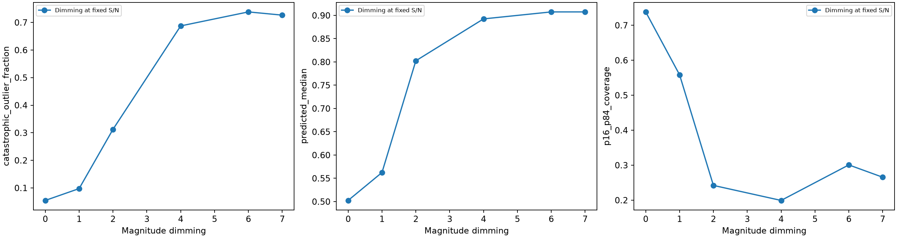
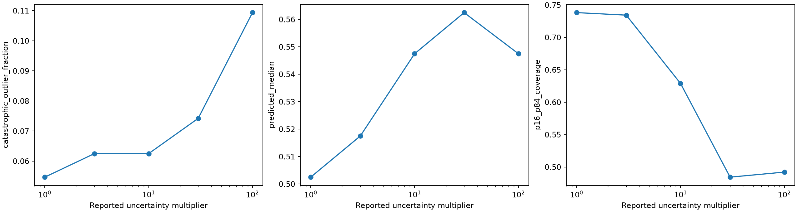
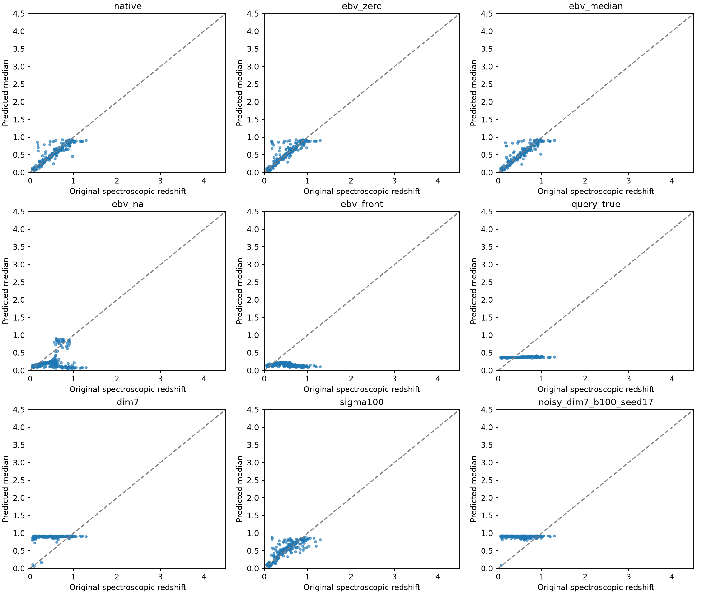
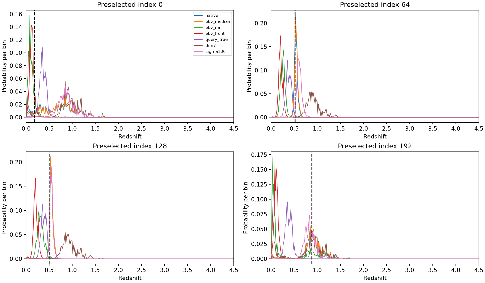

# Stage 0.5 — Frozen interface, brightness and noise diagnostics

All interventions use the original completed HSC QLoRA adapter and its trained 300-bin 0–4.5 PDF head. No new head, optimizer or weight update is used. Screening uses the first 256 original source-validation objects; six controls were fixed in advance for the entire 5,683-object validation cohort. Reference labels are DESI spectroscopy. No CLAUDS labels or astrophysical held-out test objects are read.

## Verified architecture

The original field order is ['HSC_PDR2_cmodel_g_flux', 'HSC_PDR2_cmodel_g_flux_error', 'HSC_PDR2_cmodel_r_flux', 'HSC_PDR2_cmodel_r_flux_error', 'HSC_PDR2_cmodel_i_flux', 'HSC_PDR2_cmodel_i_flux_error', 'HSC_PDR2_cmodel_z_flux', 'HSC_PDR2_cmodel_z_flux_error', 'HSC_PDR2_cmodel_y_flux', 'HSC_PDR2_cmodel_y_flux_error', 'MW_EBV']. Five-decimal numeric EBV is the final field. There is no appended query token. Actual padding masks/last-token IDs are saved for every input. A forward pre-hook captured the exact 2,560-dimensional vector entering the existing 256-hidden-unit PDF head; a separate backbone hook verifies bit-exact equality with last non-padding token pooling for every batch. This tests the implementation, not just its intended configuration.

Training EBV median is 0.034772; q05/q95 are [0.016060697846114635, 0.07298166528344144]. Perturbations are ±0.00113842, clipped to [0, observed training maximum]. Zero, median, true/shuffled and perturbation controls retain five-decimal formatting. Numeric changes still change token identity; they do not uniquely isolate semantics. The fixed ordinary-text marker is '\nPredict redshift PDF:'; no embeddings are added. Field-order/marker formats were not trained, so this is an interface stress test rather than a matched architecture comparison.

## Full validation: prespecified controls

| Condition | N | CE | NMAD | Outliers | Bias | CRPS | Coverage | Median prediction | Concentration width .03 |
|---|---:|---:|---:|---:|---:|---:|---:|---:|---:|
| full_native | 5683 | 2.4530 | 0.0268 | 1.07% | +0.0007 | 0.0274 | 73.02% | 0.2625 | 15.70% |
| full_ebv_median | 5683 | 2.4597 | 0.0267 | 1.13% | +0.0014 | 0.0274 | 73.15% | 0.2475 | 15.64% |
| full_ebv_na | 5683 | 4.8899 | 0.0941 | 23.60% | -0.0711 | 0.1150 | 43.59% | 0.1725 | 29.69% |
| full_ebv_front | 5683 | 6.1777 | 0.1274 | 31.97% | -0.0958 | 0.1607 | 26.62% | 0.1575 | 42.18% |
| full_query_true | 5683 | 7.0727 | 0.1921 | 45.54% | +0.0637 | 0.1553 | 11.40% | 0.3675 | 96.87% |
| full_dim7 | 5683 | 6.1815 | 0.2764 | 92.63% | +0.4626 | 0.4003 | 24.76% | 0.9075 | 79.80% |

## Screening factorial controls

| Condition | NMAD | Outliers | Coverage | Median z | Median S/N | Joint support-distance ratio |
|---|---:|---:|---:|---:|---:|---:|
| screen_native | 0.0303 | 5.47% | 73.83% | 0.5025 | 395.66 | 0.390 |
| screen_ebv_zero | 0.0305 | 6.64% | 75.00% | 0.5250 | 395.66 | 0.390 |
| screen_ebv_median | 0.0308 | 5.86% | 76.17% | 0.5025 | 395.66 | 0.390 |
| screen_ebv_shuffle | 0.0308 | 5.86% | 75.00% | 0.5025 | 395.66 | 0.390 |
| screen_ebv_plus | 0.0320 | 6.64% | 73.44% | 0.5100 | 395.66 | 0.390 |
| screen_ebv_minus | 0.0300 | 5.86% | 72.27% | 0.5025 | 395.66 | 0.390 |
| screen_ebv_na | 0.1854 | 43.75% | 29.69% | 0.1725 | 395.66 | 0.390 |
| screen_ebv_omit | 0.1901 | 52.34% | 16.41% | 0.1425 | 395.66 | 0.390 |
| screen_ebv_front | 0.2002 | 60.55% | 8.98% | 0.1425 | 395.66 | 0.390 |
| screen_query_true | 0.1784 | 48.83% | 8.59% | 0.3675 | 395.66 | 0.390 |
| screen_query_median | 0.1788 | 48.44% | 9.38% | 0.3675 | 395.66 | 0.390 |
| screen_query_na | 0.1850 | 52.73% | 8.98% | 0.3525 | 395.66 | 0.390 |
| screen_dim1 | 0.0399 | 9.77% | 55.86% | 0.5625 | 395.66 | 0.639 |
| screen_dim2 | 0.0810 | 31.25% | 24.22% | 0.8025 | 395.66 | 1.504 |
| screen_dim4 | 0.2242 | 68.75% | 19.92% | 0.8925 | 395.66 | 3.732 |
| screen_dim6 | 0.2630 | 73.83% | 30.08% | 0.9075 | 395.66 | 6.128 |
| screen_dim7 | 0.2668 | 72.66% | 26.56% | 0.9075 | 395.66 | 7.379 |
| screen_sigma3 | 0.0274 | 6.25% | 73.44% | 0.5175 | 131.89 | 1.161 |
| screen_sigma10 | 0.0351 | 6.25% | 62.89% | 0.5475 | 39.57 | 5.899 |
| screen_sigma30 | 0.0450 | 7.42% | 48.44% | 0.5625 | 13.19 | 23.736 |
| screen_sigma100 | 0.0504 | 10.94% | 49.22% | 0.5475 | 3.96 | 106.172 |
| screen_noisy_dim0_b100_seed17 | 0.0747 | 14.45% | 39.06% | 0.5625 | 4.07 | 113.668 |
| screen_noisy_dim0_b100_seed29 | 0.0730 | 14.45% | 33.98% | 0.5625 | 4.18 | 123.043 |
| screen_noisy_dim0_b100_seed43 | 0.0655 | 16.41% | 41.80% | 0.5550 | 4.33 | 124.540 |
| screen_noisy_dim4_b30_seed17 | 0.2315 | 71.88% | 18.75% | 0.8925 | 12.99 | 22.645 |
| screen_noisy_dim4_b30_seed29 | 0.2193 | 72.27% | 18.36% | 0.8925 | 12.98 | 23.786 |
| screen_noisy_dim4_b30_seed43 | 0.2287 | 71.09% | 18.75% | 0.8925 | 13.69 | 22.419 |
| screen_noisy_dim7_b100_seed17 | 0.2788 | 72.66% | 19.92% | 0.9075 | 4.07 | 27.296 |
| screen_noisy_dim7_b100_seed29 | 0.2807 | 72.66% | 19.53% | 0.9075 | 4.18 | 27.951 |
| screen_noisy_dim7_b100_seed43 | 0.2777 | 73.44% | 19.53% | 0.9075 | 4.33 | 27.918 |

## Five causal questions

1. **EBV semantics versus interface:** screening outliers are true=5.47%, zero=6.64%, median=5.86%, shuffle=5.86%, small plus/minus=6.64%/5.86%, and NA=43.75%. Full-validation median/NA controls are in the table above. Different outcomes for numeric alternatives and NA limit any interpretation in terms of astrophysical EBV alone; token identity and the terminal representation also change. No unique semantic/token causal decomposition is claimed.

2. **Order invariance:** moving true EBV before photometry changes predictions by mean absolute |delta z|=0.1699 on all validation objects, with mean representation cosine 0.858504. Adding the fixed ordinary marker with true EBV gives |delta z|=0.1868. These preserve physical observations but are untrained input formats; they test fragility, not superiority of another pooling architecture.

3. **Brightness at fixed S/N:** seven-mag dimming changes full-validation outliers from 1.07% to 92.63%, predicted median from 0.2625 to 0.9075, and concentration in width .03 from 15.70% to 79.80%. Colours and unrounded S/N are invariant. This demonstrates strong flux-scale dependence, while a brightness-dependent population prior can be physically legitimate.

4. **Reported S/N versus noise:** sigma x100 at fixed measured flux gives 10.94% outliers and median z=0.5475; the native screening values are 5.47% and 0.5025. The nine seeded actual-noise rows quantify the separate perturbation. Neither intervention alone is a realistic survey population change.

5. **Direction of CLAUDS failure:** with true EBV held fixed, extreme dimming leads to median z=0.9075; NA EBV without dimming leads to median z=0.1725. Compare these measured directions with the archived CLAUDS low-z collapse (~0.08–0.13). The source interventions expose mechanisms and can reproduce concentration, but do not uniquely reconstruct the full CLAUDS failure or substitute for its different population/measurement pipeline.

All brightness cases multiply measured flux and error together by 10**(-0.4*delta_mag), preserving unrounded colour ratios and S/N. Five-decimal serialization quantization, including any errors that round to zero, is measured in the numerical audit; no extra precision is silently substituted. Dimming is a counterfactual measurement scale, not a physical relocation or a new redshift label. Apparent brightness can carry a valid population prior. Uncertainty-only changes alter the report, not the measured realization. Noise cases add independent Gaussian variance sigma_target²−sigma_scaled², with three fixed seeds per cell; negative measurements are preserved. This is not an image-level noise simulator.

Paired representation cosine, normalized displacement, maximum logit differences, Jensen–Shannon PDF divergence and prediction changes are in representation_changes.csv and paired_objects.csv. Conditional metrics use original spectroscopic-redshift intervals and source-training brightness/S/N terciles; no configuration is chosen by error. Source-distance ratios use exactly Stage 0 fold-0 preprocessing, neighbours and thresholds. Raw inputs, token IDs/masks, actual pooled representations and PDF logits/probabilities are saved.

## Correctness review and verdict

Numerical EBV, token identity/position and the pooled terminal state remain coupled; use the paired numerical, missingness, position and marker controls to delimit sensitivity, without claiming unique causal attribution. Reordering or appending text leaves the physical observations fixed and directly tests serialization fragility. Brightness-only and uncertainty-only conditions separate population-prior response from reported-S/N dependence; stochastic cases test the interaction. None proves absence of pretrained astrophysical information.

No archived weight, grid or split changes. Native replay is checked independently on each worker. The first screening attempt omitted the archived BF16 autocast context; its native replay failed and blocked expansion. That preliminary output is retained only under superseded-fp32-screen/INVALID.md and excluded from scientific tables. Corrected screening reproduces the archived native logits exactly. The full gate opens only after all screening correctness checks pass. The source unit conversion is unchanged, fluxes/errors stay in nMgy, true EBV/redshifts stay fixed in brightness/noise experiments, and missingness remains explicit. The original five-decimal interface is intentionally retained even where counterfactual dimming exposes inadequate precision (numerical_precision_audit.csv). This limitation must not be copied into Stage 1: synthetic flux/error serialization will use sufficient scientific precision and a fixed ordinary query marker for matched frozen probes. Stage 1 must integrate the full photon response rather than sample pivots, test AB normalization, and separate SED identities before generating redshifts/filters.

There is no blocker to independent Stage-1 controlled synthetic diagnostics: Stage 0.5 reveals fragility of this historical interface, not an error that makes a separately unit-tested forward benchmark invalid. Stage 1 may proceed with a frozen benchmark protocol, without tuning to these predictions or CLAUDS labels. A trustworthy production cross-survey photo-z interface and the degree of remaining real-domain shift are not established here.

The optional archived MLP/template comparison was not executed: no matching trained numerical baseline plus preprocessing contract was available in the primary HSC run. No new baseline was trained during Stage 0.5.
