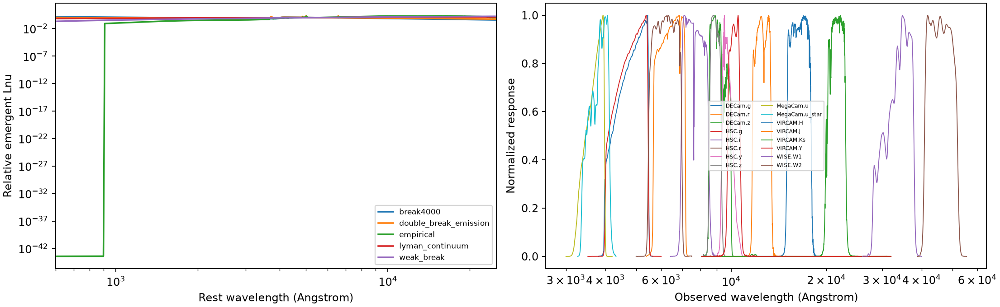
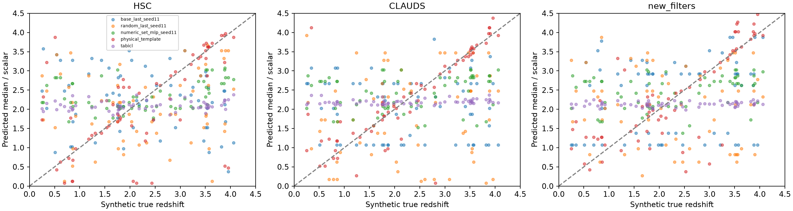
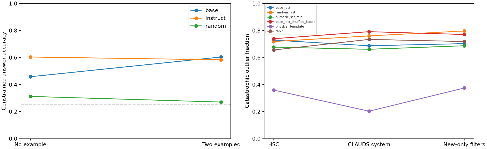
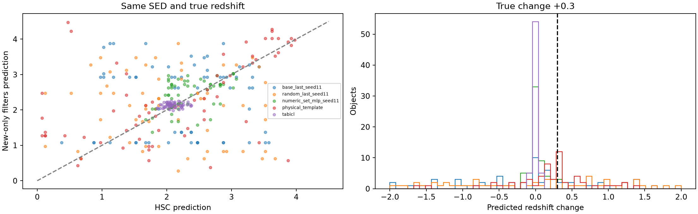

# Stage 1 — Controlled physics, pretraining and cross-filter transfer

This is a small **synthetic** benchmark. It does not establish success on real
CLAUDS. Stage 0.5 completed and passed its correctness gate before Stage 1 began.
No real CLAUDS redshift labels or held-out real-survey test objects are used.
Only small source-synthetic probes are trained; Qwen backbones stay frozen.

## Physical benchmark and controls

The fixed benchmark has **208 unique emergent SED instances**, 1,312 observations,
and 512 labelled source observations (128 SEDs x two redshifts x HSC/Legacy).
Validation has 24 SEDs; primary test has 32; the double-break/emission family has
24 additional held-out SEDs. An ID split precedes every redshift, noise or filter
realization. No complete emergent spectrum repeats across splits. Primary
empirical instances share CWW base-library templates but have independent
continuous dust/slope parameters; this is not a base-library-template-disjoint
test. The entire double-break/emission combination is unseen in source training.

Families include a 4000-Angstrom break, UV/Lyman continuum, weak-break controls,
four pinned extended CWW empirical galaxy templates, and a held-out family with
Balmer/4000 breaks plus emission lines. Continuum slopes, break strengths,
power-law dust attenuation and independent luminosities are explicit. Mean IGM
attenuation is a documented simplified line/ionizing screen, not a validated
survey population model. The CWW files and source commit/hashes are vendored
unchanged from the [EAZY template repository](https://github.com/gbrammer/eazy-photoz/tree/master/templates/CWW%2BKIN).

Spectra are redshifted with the luminosity-distance factor, then fully integrated
through actual pinned photon-response curves, using original knots plus a
5-Angstrom grid. AB normalization uses 3631 Jy; f_lambda*lambda*R weighting and
the c*integral(R/lambda) denominator preserve constant f_nu. These conventions
follow the [photon-response convolution documentation](https://speclite.readthedocs.io/en/latest/api/speclite.filters.FilterResponse.html)
and [cosmological distance relations](https://ned.ipac.caltech.edu/level5/Hogg/Hogg7.html).
Seven forward tests and four leakage/counterfactual checks pass. A smooth flat
f_nu continuum has no low-z colour-redshift information after amplitude removal;
poor predictions there can reflect genuine non-identifiability.

All raw fluxes/errors, clean measurements, spectra, nuisances, response samples
and seeds are saved. Independent Gaussian measurement errors use a redshift-
independent RMS-S/N nuisance, not a calibrated survey image/exposure model.
Supervised inputs remove overall amplitude using observed RMS, retaining signed
fluxes and relative errors. Physical luminosities are independent of redshift;
survey identities and intrinsic truth/SED IDs never enter model strings. Source
filter systems observe exactly the same SED/redshift instances, so source survey
or record length alone cannot determine the label. Band order is permuted.
`shortcut_audit.csv` documents token-length and amplitude checks. New-only filters
are all absent from source training. Different target band counts/coverage remain
part of the transfer challenge and prevent attribution to bandpass identity alone.

## Probe A — Explicit reasoning before photo-z probe fitting

The interface scores four one-token option completions with the tied LM
unembedding. It is a constrained completion test, not free-form generation.
No-example and fixed two-example conditions are separate. Base and compatible
Instruct checkpoints are separate; instruction tuning is not astrophysical
pretraining. No prompt was tuned on these answers.

| Checkpoint | Examples | Correct / 48 | Accuracy | Wilson 95% interval |
|---|---:|---:|---:|---:|
| base | 0 | 22 | 45.83% | 32.58%–59.71% |
| base | 2 | 29 | 60.42% | 46.31%–72.98% |
| instruct | 0 | 29 | 60.42% | 46.31%–72.98% |
| instruct | 2 | 28 | 58.33% | 44.28%–71.15% |
| random | 0 | 15 | 31.25% | 19.95%–45.33% |
| random | 2 | 13 | 27.08% | 16.57%–41.00% |

The explicit arithmetic/rule baseline scores 48/48, using supplied wavelengths,
known named-line rest wavelengths, the redshift relation, ambiguity rules and AB
filter normalization. Task-specific results and every correct/incorrect model
answer, logits, actual input IDs/masks and prompt are saved. Pretraining improves
some constrained completions over the full random architecture, particularly
ambiguity recognition; the named-feature tasks are small and inconsistent.
These results do not establish reliable astrophysical numerical reasoning.
Base-checkpoint prompt sensitivity does not establish absence of information.

## Probe B/C — Frozen representations and held-out filter systems

The full frozen random text architecture has 4.206 billion parameters, matching
the pretrained text stack; the unused vision branch is omitted. Both use NF4
double quantization with BF16 compute, identical tokenizer and 2,560-dimensional
representations. Primary pooling is a fixed ordinary terminal query; mean pooling
is a predeclared secondary condition, not chosen by target performance.

Pretrained/random heads are identical 2560->32->90 MLPs. The numerical control
uses shared per-band MLP/set aggregation and a parameter-matched head (see exact
budgets). Both receive normalized photometry, uncertainties, response summaries
and masks. Each uses the same 512 source observations, 400 AdamW updates, batch
64, learning rate 0.002 and three predeclared initialization seeds. All feature
normalization is fitted on source training only. No target-filter labels choose
hyperparameters, updates, checkpoint or pooling. Label-shuffled pretrained-head,
scalar ExtraTrees and frozen in-context TabICL controls are included.

The source-fit diagnostic matters. At predeclared seed 11, pretrained and random
last-pool heads achieve source-training CE
0.0273 and
0.0176, with 0/512
catastrophic outliers in both cases. They fit the supervised examples but fail
to generalize well across independent SED instances. The numerical set MLP has
training CE 3.1968;
its effective capacity/optimization differs despite matched parameter and update
budgets. Thus parameter matching does not guarantee identical fit quality. This
measures sample/inductive-bias behaviour under a fixed small protocol, not an
optimally tuned comparison of every architecture. No evaluation labels are used
to fix this after seeing results. Training fits are not independent validation.

The physical baseline profiles a nonnegative luminosity scale over 20 fixed
analytic/CWW prototypes and 90 redshift bins, using the actual supplied response
curves. Its prototype grid is independent of test SED identities. Its PDF is an
equal-template profile-likelihood pseudo-posterior, not a calibrated Bayesian
posterior. Scalar baselines do not receive invented CE/CRPS/coverage metrics.

The following values are means over three head seeds where applicable; seed
dispersion is in aggregate_performance.csv, and uncertainty from SED sampling is
addressed by cluster_bootstrap.csv. Two redshifts per test SED are not independent
galaxy-template draws.

| Model | Evaluation | N | NMAD | Outliers | Bias | CE | CRPS | Coverage |
|---|---|---:|---:|---:|---:|---:|---:|---:|
| base_last | test_HSC_correct | 64 | 0.4310 | 72.92% | +0.1559 | 11.2482 | 0.8791 | 34.4% |
| random_last | test_HSC_correct | 64 | 0.4211 | 71.88% | +0.1100 | 10.8241 | 0.8571 | 37.0% |
| numeric_set_mlp | test_HSC_correct | 64 | 0.2731 | 67.71% | +0.1771 | 6.6778 | 0.6190 | 57.8% |
| base_last_shuffled_labels | test_HSC_correct | 64 | 0.4587 | 73.96% | +0.1443 | 11.5623 | 0.8904 | 32.8% |
| physical_template | test_HSC_correct | 64 | 0.0616 | 35.94% | +0.0439 | 7.7834 | 0.4731 | 51.6% |
| numeric_extra_trees | test_HSC_correct | 64 | 0.3622 | 73.44% | +0.1059 | — | — | — |
| tabicl | test_HSC_correct | 64 | 0.4196 | 65.62% | +0.1027 | — | — | — |
| base_last | test_CLAUDS_correct | 64 | 0.4046 | 68.75% | +0.2468 | 16.3652 | 0.8989 | 24.5% |
| random_last | test_CLAUDS_correct | 64 | 0.4155 | 76.04% | +0.0665 | 13.4647 | 0.9166 | 28.1% |
| numeric_set_mlp | test_CLAUDS_correct | 64 | 0.2993 | 66.15% | +0.2119 | 7.8745 | 0.6316 | 58.3% |
| base_last_shuffled_labels | test_CLAUDS_correct | 64 | 0.3919 | 79.17% | +0.0504 | 17.5252 | 1.0116 | 22.4% |
| physical_template | test_CLAUDS_correct | 64 | 0.0497 | 20.31% | +0.0688 | 21.7318 | 0.2323 | 29.7% |
| numeric_extra_trees | test_CLAUDS_correct | 64 | 0.3628 | 71.88% | +0.0567 | — | — | — |
| tabicl | test_CLAUDS_correct | 64 | 0.4013 | 73.44% | +0.1397 | — | — | — |
| base_last | test_new_filters_correct | 64 | 0.4746 | 70.31% | +0.2536 | 16.5896 | 0.8968 | 27.1% |
| random_last | test_new_filters_correct | 64 | 0.5017 | 79.69% | +0.1055 | 14.8743 | 1.0288 | 19.3% |
| numeric_set_mlp | test_new_filters_correct | 64 | 0.3430 | 68.75% | +0.2256 | 7.6727 | 0.6255 | 59.4% |
| base_last_shuffled_labels | test_new_filters_correct | 64 | 0.3602 | 77.08% | -0.0326 | 18.1429 | 0.9726 | 22.4% |
| physical_template | test_new_filters_correct | 64 | 0.1494 | 37.50% | +0.0662 | 14.7880 | 0.4018 | 21.9% |
| numeric_extra_trees | test_new_filters_correct | 64 | 0.3260 | 75.00% | +0.1067 | — | — | — |
| tabicl | test_new_filters_correct | 64 | 0.4170 | 71.88% | +0.1179 | — | — | — |

On the strict new-only filters, primary pretrained outliers are
**70.31%**, compared with
**79.69%** for full random features,
**68.75%** for the numerical MLP, and
**37.50%** for the physical baseline.
These empirical differences support only the tested small protocol; three head
seeds do not cover random-backbone initialization or all possible SED populations.
The one random-backbone initialization and limited labels are explicit limits.
The primary last-pool head has a modest average advantage over random features
on the held-out systems, but the predeclared seed-11 SED-cluster intervals include
zero for those outlier differences. It does not beat the numerical MLP overall,
and the secondary mean-pool comparison does not show the same pretraining gain.
Thus there is no robust, general pretrained-representation advantage established
by this small study. The physical baseline performs substantially better, while
also having access to the complete forward law/response curves; learned probes
receive response summaries, not every response sample in their feature vectors.

The stronger unseen-family test gives:

| Model | Evaluation | N | NMAD | Outliers | Bias | CE | CRPS | Coverage |
|---|---|---:|---:|---:|---:|---:|---:|---:|
| base_last | family_holdout_CLAUDS_correct | 48 | 0.6422 | 80.56% | +0.4835 | 16.7862 | 1.1782 | 18.1% |
| random_last | family_holdout_CLAUDS_correct | 48 | 0.6426 | 80.56% | +0.3406 | 13.1846 | 1.0599 | 26.4% |
| numeric_set_mlp | family_holdout_CLAUDS_correct | 48 | 0.7635 | 79.86% | +0.5521 | 8.4639 | 0.8676 | 45.1% |
| physical_template | family_holdout_CLAUDS_correct | 48 | 0.0758 | 29.17% | +0.3741 | 45.0540 | 0.7856 | 8.3% |
| tabicl | family_holdout_CLAUDS_correct | 48 | 0.6294 | 83.33% | +0.3563 | — | — | — |
| base_last | family_holdout_new_filters_correct | 48 | 0.5645 | 78.47% | +0.3661 | 19.4860 | 1.0601 | 18.8% |
| random_last | family_holdout_new_filters_correct | 48 | 0.6756 | 81.94% | +0.3095 | 15.2605 | 1.0242 | 25.7% |
| numeric_set_mlp | family_holdout_new_filters_correct | 48 | 0.7329 | 81.94% | +0.5444 | 8.3085 | 0.8607 | 47.2% |
| physical_template | family_holdout_new_filters_correct | 48 | 0.3583 | 58.33% | +0.3125 | 42.0173 | 0.8983 | 10.4% |
| tabicl | family_holdout_new_filters_correct | 48 | 0.6722 | 81.25% | +0.3298 | — | — | — |

## Physical counterfactuals

Paired observations retain the same intrinsic SED, luminosity, dust and redshift;
only responses/noise realizations change. Wrong metadata leaves actual fluxes and
errors identical. Redshift-response pairs instead keep the intrinsic SED fixed
and regenerate photometry at z+0.3. Neither ID, seed nor the answer is provided.

| Model (predeclared seed 11 where applicable) | Contrast | Mean absolute prediction shift | Mean absolute response error |
|---|---|---:|---:|
| base_last_seed11 | HSC_to_CLAUDS | 0.8336 | 0.8336 |
| base_last_seed11 | HSC_to_new_filters | 1.0242 | 1.0242 |
| base_last_seed11 | wrong_metadata | 0.7484 | 0.7484 |
| base_last_seed11 | redshift_plus03 | 0.8398 | 0.9352 |
| numeric_set_mlp_seed11 | HSC_to_CLAUDS | 0.3484 | 0.3484 |
| numeric_set_mlp_seed11 | HSC_to_new_filters | 0.2984 | 0.2984 |
| numeric_set_mlp_seed11 | wrong_metadata | 0.0930 | 0.0930 |
| numeric_set_mlp_seed11 | redshift_plus03 | 0.0789 | 0.2711 |
| physical_template | HSC_to_CLAUDS | 0.6477 | 0.6477 |
| physical_template | HSC_to_new_filters | 0.7617 | 0.7617 |
| physical_template | wrong_metadata | 1.5508 | 1.5508 |
| physical_template | redshift_plus03 | 0.7500 | 0.6844 |
| random_last_seed11 | HSC_to_CLAUDS | 1.1680 | 1.1680 |
| random_last_seed11 | HSC_to_new_filters | 1.0633 | 1.0633 |
| random_last_seed11 | wrong_metadata | 1.0297 | 1.0297 |
| random_last_seed11 | redshift_plus03 | 1.0844 | 1.0844 |
| tabicl | HSC_to_CLAUDS | 0.1348 | 0.1348 |
| tabicl | HSC_to_new_filters | 0.1147 | 0.1147 |
| tabicl | wrong_metadata | 0.0069 | 0.0069 |
| tabicl | redshift_plus03 | 0.0226 | 0.2991 |

A response to incorrect metadata alone is not evidence of physics. The paired
invariance and known-redshift-change tests, together with template and random
controls, delimit that interpretation. `conditional_physics_metrics.csv`
contains results by SED family, redshift and S/N; the held-out double-break family
is reported independently. All noise/missing-band and secondary-pooling results
remain in the machine-readable tables without error-based filtering.
Even a valid physical estimator can shift its posterior median when the noise
realization, coverage or degeneracy changes. The invariant quantity here is the
true redshift; exact equality of noisy point estimates is not a universal physics
criterion. The template comparison helps expose those information limits.

## Claims and the four requested answers

1. **Usable physical information under an interface:** some constrained explicit
   physical-consistency/ambiguity responses are usable. The complete table and
   cross-filter tests define the narrower numerical limits. This is not a
   reliable general physical solver or proof of real-CLAUDS transfer.
2. **Benefit from pretraining:** pretrained-versus-random head tables directly
   show a limited, pooling-dependent gain on some held-out filters, without a
   robust advantage over numerical controls. Reasoning differs from the random control before any
   supervised photo-z head training. Those comparisons isolate general
   pretraining effects within this protocol, not astrophysical training content.
3. **Transfer to unseen responses:** report the strict new-only and CLAUDS-system
   errors and paired shifts above: roughly 70% primary-head outliers do not
   demonstrate reliable cross-filter redshift transfer. Correct source accuracy
   or sensitivity to shuffled tokens would not by itself establish invariance.
4. **Stage-2 justification:** these tests motivate controlled trials of explicit
   filter integration, masked set-like band representations and stable pooling.
   They do not justify an expensive Qwen-specific physics architecture solely on
   presumed pretrained astrophysical knowledge. Retain the full random-feature,
   numerical, shuffled-label and template controls and a frozen-backbone branch.

**Claim 1 (physical behaviour)** is task/interface dependent and constrained by
the explicit and paired measurements. **Claim 2 (a pretraining benefit)** can be
assessed from matched head differences, with sampling limits. **Claim 3 (specifically
astrophysical pretraining causes the benefit)** is not established: generic
numeric/text representations and ambiguity heuristics remain explanations, and
named-feature retrieval is not consistently strong. Successful synthetic
supervised regression alone would not establish this stronger claim.

## Reproduction

manifest.json fixes all simulation/split/probe choices before model outputs;
the preflight q50 bookkeeping change gave numerical controls the same response
summaries as Qwen before any model probe. Actual commands, environment versions,
template/response hashes and random initialization hashes are saved. Final
provenance verifies archived checkpoints and records the prior-stage gate.
No original adapter, trained PDF head, validation split or historical result is
overwritten. No SFT, QLoRA, DoRA or large-model weight training is performed.
