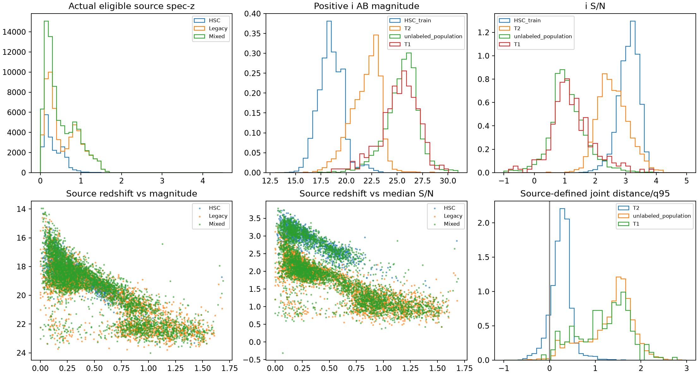

# Stage3A readiness —1029

Verdict: ready for the preregistered compact real-survey Stage3B experiment. Independent source population and independent target spectroscopy are available; high-z supervised generalisation is unsupported.

The historical Legacy population was recovered by the original seed42 priority sampling and imaging-group deduplication on exactly fingerprint-matched inputs. All15,053 original validation IDs, redshifts, five-band fluxes/errors and EBV reproduce exactly. Original counts are59,855 train,15,053 validation,225,080 test. Test IDs/astrometry are used only for exclusions; no source-test performance is evaluated.

[Official DESI documentation](https://data.desi.lbl.gov/doc/releases/dr1/vac/lsdr9-photometry/) verifies the Iron/DR9 v1.1 release. The existing main bright/dark spectroscopic and min3-band cuts are preserved. After old-test collisions, ambiguities, union-validation promotion and COSMOS spatial holdout, eligible populations are:

{'T2_final_count': 2045, 'T2_legacy_historical_membership_exclusions': 3, 'T2_historical_source_overlap_policy': 'Exclude target matches to all HDF positions and all sampled Legacy train/val/test astrometry, using only identity/astrometry downstream; original reconstruction transiently reads raw rows before discarding test photometry', 'source_ambiguous_Legacy_groups': 2, 'HSC_to_Legacy_mapping_count': 134509, 'source_identity_match_max_arcsec': 1.0, 'group_rule': 'verified unique same TARGETID and <=1 arcsec map to Legacy imaging key; ambiguity removed; any historical test collision excluded; union validation wins', 'different_identity_close_pairs': 0, 'ambiguous_spatial_groups': 0, 'source_old_test_spatial_collision_rows': 848, 'HSC': {'original_trainval': 28127, 'excluded_test_or_ambiguous': 444, 'excluded_spatial_COSMOS': 1073, 'train': 21207, 'validation': 5403}, 'Legacy': {'original_trainval': 74908, 'excluded_test_or_ambiguous': 404, 'excluded_spatial_COSMOS': 292, 'train': 59266, 'validation': 14946}, 'mixed_unique_galaxies': 100696, 'mixed_shared_galaxies': 126, 'mixed_view_rule': 'One deterministic SHA256 chosen real view per galaxy; balanced survey sampling; never synthesize joint apertures'}

The actual recovered Legacy training redshift-bin counts before these extra exclusions are33,095 /17,072 /9,242 /446 /0 /0 for[0,.5,1,1.5,2,3,4.5]. This measures the full historical training population, not the small paired pilot. Eligible HSC, Legacy and deduplicated union coverage and joint magnitude/SNR/colour arrays are saved separately.

Independent T2 is drawn from the [COSMOS team release](https://cosmos.astro.caltech.edu/page/specz), pinned to the downloaded DR1.1 file hash and data commit. Its [quality definitions](https://arxiv.org/html/2503.00120v1) support the strict flag4 confidence cut. Corrected coordinates must match within0.5arcsec with no second counterpart within1arcsec, and duplicate/morphological/star flags are excluded. All historical HSC objects and historical Legacy sampled train/val/test matches are excluded.2,045 identities are reserved; their new spec-z values have not been read. Final positive-redshift/grid and band eligibility is fixed before label access.

T2 is substantially brighter than the local unlabeled galaxy sample: median positive i AB magnitude22.13 versus25.71. The HSC-source-defined common-support fractions are9.54% and0.59%. This is a descriptive feature-space test, not a universal density. Spectroscopic confirmation cannot establish accuracy for the faint population.

S1/S2 preserve original train/validation roles with union validation and all old-test exclusions. E3 uses independently sampled populations, deduplicated to one deterministic observed view per galaxy, then balances surveys. S3 remains an explicitly shared-galaxy diagnostic. T1 remains the previously inspected256 ZPHOT-only exploratory objects; T3 is omitted.

Input checks pass: signed flux/error normalization, SNR preservation, empty/missing masks, canonical-slot and set permutation invariance, finite gradients, all21 response identities and pinned corrected physical kernel. Brightness is a separate fixed source-only ablation. Capacity and full-response/generic-basis controls are specified. A source-validation gate must pass before T2 labels open.

No Qwen training or Stage2C is authorized by this readiness verdict. Frozen Qwen inference is retained with native-interface replay and explicit missing EBV. Original Stage0–2 artifacts are protected.

Reproduction: stage3_recover_1029.py; stage3_data_1029.py target/background/legacy/finalize; stage3_models_1029.py; stage3_support_1029.py; stage3_train_1029.py freeze then run. See benchmark.json and benchmark_lock.json for the immutable specification.

Eligible source-training counts by redshift bin:

| Source |0–0.5|0.5–1|1–1.5|1.5–2|2–3|3–4.5|
|---|---:|---:|---:|---:|---:|---:|
|HSC|16,004|5,043|153|7|0|0|
|Legacy|32,760|16,895|9,167|444|0|0|
|Deduplicated union|48,716|21,912|9,320|451|0|0|

The shared-source truth audit found125 identical spectroscopic IDs and one repeated-spectroscopy object with a different TARGETID on the same imaging identity. Its normalized redshift difference is2.64e-6, within the original HSC native-vs-Iron tolerance0.001; it is validation-only and is not relabeled. No inconsistent truth join is retained.

Read-boundary clarification: exact historical reconstruction executes the original catalogue sampler on raw spectroscopy/photometry, including rows that become historical test members. Only their identity/astrometry is retained for exclusions; no source-test prediction, metric, model selection or training uses them. Target confirmation redshifts remain separately quarantined until the source gate.
