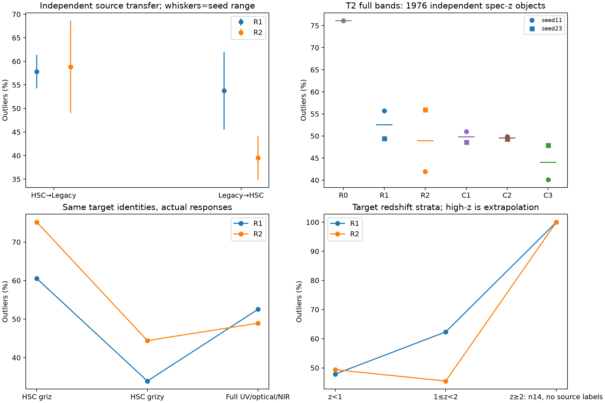
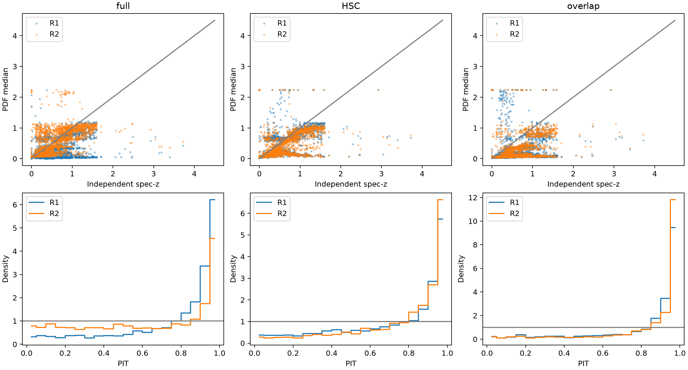
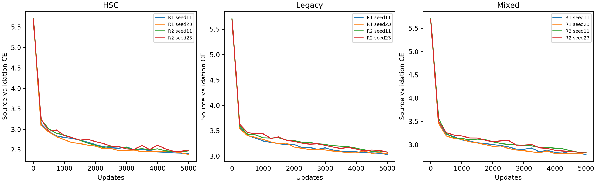

# Stage3B — compact real-survey benchmark,1029

The independent target result does **not** establish a stable FSPS-kernel advantage. On1,976 reserved spectroscopic galaxies, Mixed R1→R2 full-band outliers change55.67%→41.95% in seed11, but49.39%→55.92% in seed23. Their paired differences are−13.71pp[−16.19,−11.08] and+6.53pp[+3.85,+9.06]. The generic smooth-basis C3 has40.13%/47.93% outliers, lower than FSPS R2 in both seeds; seed11 R2−C3 is not distinguishable from zero, while seed23 significantly favours C3. Thus the registered two-seed target success criterion fails, and external FSPS information is not established as the cause of a robust gain.

Legacy→HSC transfer shows point-error improvements in both seeds (−10.60pp and−17.90pp), but HSC→Legacy changes direction (+14.37pp and−12.39pp). Source CE, CRPS and point metrics also disagree in some arms. Only1/12 primary runs meets the final source-plateau rule, so these are compact-budget results rather than a fully converged architecture ranking.

The physical D12 baseline has24.09% full-band target outliers, but CE163,658 and only12.55% nominal68% coverage: improved point errors coexist with a severely overconfident, inadequate PDF. D2 has86.49% outliers and is a failed constrained diagnostic. Frozen Qwen has74.09% outliers on these same objects through its original grizy/NA-EBV interface; this comparison does not isolate pretraining or equalize source supervision. All14 z≥2 targets are outliers for both primary architectures and seeds, and neither source population contains z≥2 supervision.

The benchmark uses genuinely independent recovered Legacy supervision and a newly reserved COSMOS spectroscopic confirmation cohort. All20 compact numerical fits and source-only checkpoint selection completed before opening T2 redshifts. The source-learning gate passed. Results are conditional on the fixed5000-update budget; final source convergence is assessed separately.

## Independent source transfer

| Direction/model | N | Outliers | NMAD | CE | CRPS |68% coverage |
|---|---:|---:|---:|---:|---:|---:|
|E1_HSC_R1_seed11|14894|0.5426|0.2726|6.5183|0.3668|0.5310|
|E1_HSC_R1_seed23|14894|0.6141|0.1711|7.5559|0.2250|0.4838|
|E1_HSC_R2_seed11|14894|0.6863|0.5968|6.0479|0.5713|0.4058|
|E1_HSC_R2_seed23|14894|0.4901|0.2180|7.9647|0.2898|0.1417|
|E2_Legacy_R1_seed11|5351|0.4551|0.1478|9.2231|0.2776|0.9908|
|E2_Legacy_R1_seed23|5351|0.6204|0.3055|9.5204|0.2504|0.9927|
|E2_Legacy_R2_seed11|5351|0.3491|0.1248|5.4094|0.1992|0.4650|
|E2_Legacy_R2_seed23|5351|0.4414|0.1412|5.5101|0.2832|0.4453|

E1 and E2 exclude every identity shared with the other survey. They contain14,894 independent Legacy validation galaxies and5,351 independent HSC validation galaxies. Old source-test objects and ambiguous matches are excluded; COSMOS is spatially isolated from all source training and modelselection. S3 actual paired observations remain a separate source-validation diagnostic.

## Independent target confirmation

T2 eligibility: {"reserved": 2045, "finite_positive_in_grid": 1996, "nonfinite": 0, "nonpositive": 45, "above_grid": 4, "insufficient_full_bands": 20, "eligible": 1976, "z_bin_counts": [809, 744, 355, 54, 9, 5], "spectroscopy_surveys": {"2": 1, "14": 1, "18": 4, "20": 15, "23": 2, "31": 31, "35": 1, "37": 218, "38": 1602, "41": 2, "42": 12, "49": 2, "51": 4, "52": 1, "61": 8, "65": 2, "72": 24, "80": 1, "82": 5, "90": 7, "91": 1, "101": 1, "122": 7, "128": 1, "135": 9, "136": 14}}. References outside0<z<=4.5 and insufficient full-band observations are counted, never clipped. All models compare identical eligible objects. Restricted-band failures produce the registered uniform PDF for numerical/physical models; counts remain in the tables. Qwen retains its original missing-value interface.

| Mixed-source configuration | N | Outliers | NMAD | CE | CRPS |68% coverage |
|---|---:|---:|---:|---:|---:|---:|
|R0 seed11|1976|0.7611|0.2362|8.1995|0.5120|0.1660|
|R1 seed11|1976|0.5567|0.1870|5.9403|0.3050|0.3629|
|R1 seed23|1976|0.4939|0.1981|5.9241|0.2646|0.3735|
|R2 seed11|1976|0.4195|0.1587|5.5377|0.2191|0.4944|
|R2 seed23|1976|0.5592|0.2440|6.7613|0.2769|0.4418|
|C1 seed11|1976|0.5101|0.2103|5.6179|0.3337|0.4479|
|C1 seed23|1976|0.4858|0.1673|6.0828|0.2646|0.4226|
|C2 seed11|1976|0.4985|0.1855|5.9366|0.2735|0.3639|
|C2 seed23|1976|0.4929|0.1861|6.0653|0.2718|0.4099|
|C3 seed11|1976|0.4013|0.1545|5.3926|0.2187|0.4221|
|C3 seed23|1976|0.4793|0.2318|6.4798|0.2698|0.3735|
|R1_brightness seed11|1976|0.4863|0.2046|5.5441|0.2483|0.3866|

Primary paired galaxy bootstrap:

- Seed11: R2−R1 outliers=-13.71 percentage points;95% conditional interval[-16.19,-11.08]; CE difference=-0.403; CRPS difference=-0.0859.
- Seed23: R2−R1 outliers=+6.53 percentage points;95% conditional interval[+3.85,+9.06]; CE difference=+0.837; CRPS difference=+0.0124.

Both-seed registered outlier success criterion: False. This criterion does not supersede PDF calibration, control comparisons, source convergence or population selection. Bootstrap resamples unique galaxies jointly; training-seed variability is reported separately in training_seed_variability.csv. Two seeds do not determine a precise distribution over training randomness.

Capacity/information-control paired differences R2 minus comparator:

- C1 seed11: -9.06 percentage points;95% interval[-11.34,-6.78].
- C2 seed11: -7.89 percentage points;95% interval[-10.32,-5.41].
- C3 seed11: +1.82 percentage points;95% interval[-0.66,+4.30].
- R0 seed11: -34.16 percentage points;95% interval[-36.84,-31.63].
- C1 seed23: +7.34 percentage points;95% interval[+4.61,+10.12].
- C2 seed23: +6.63 percentage points;95% interval[+4.00,+9.31].
- C3 seed23: +8.00 percentage points;95% interval[+6.02,+9.92].

R1 has104,012 trainable parameters; R2 has157,516. C1 has156,716; C2 and C3 each157,516. C2 sees complete3600-sample numerical response curves, while C3 uses12 fixed generic smooth spectral functions. R2 additionally receives external FSPS spectra and IGM response information. These controls do not make the physical information identical. R0 canonical slots has113,900 parameters. R1_brightness is a separate fixed source-only ablation, never chosen using targets.

## Source learning and optimization limits

| Source/model | Best step | Source CE | Source outliers | Final plateau |
|---|---:|---:|---:|---|
|HSC/R1 seed11|5000|2.404|0.0141|False|
|HSC/R1 seed23|5000|2.385|0.0152|False|
|HSC/R2 seed11|4750|2.452|0.0144|False|
|HSC/R2 seed23|4750|2.464|0.0133|False|
|Legacy/R1 seed11|5000|3.031|0.0657|False|
|Legacy/R1 seed23|5000|3.049|0.0622|True|
|Legacy/R2 seed11|5000|3.082|0.0650|False|
|Legacy/R2 seed23|5000|3.080|0.0607|False|
|Mixed/C1 seed11|5000|2.920|0.0508|False|
|Mixed/C1 seed23|4750|2.927|0.0527|False|
|Mixed/C2 seed11|4750|2.956|0.0545|False|
|Mixed/C2 seed23|4500|2.970|0.0539|True|
|Mixed/C3 seed11|5000|2.990|0.0570|False|
|Mixed/C3 seed23|4500|2.978|0.0508|False|
|Mixed/R0 seed11|4500|3.161|0.0681|False|
|Mixed/R1_brightness seed11|5000|2.918|0.0495|False|
|Mixed/R1 seed11|5000|2.949|0.0517|False|
|Mixed/R1 seed23|4750|2.948|0.0511|False|
|Mixed/R2 seed11|5000|2.983|0.0549|False|
|Mixed/R2 seed23|4750|2.987|0.0518|False|

1/12 primary runs meet the registered final plateau condition. Meaningful source learning is established, but improvement from initialization is not proof of convergence. Common2500/5000 snapshots are reported in common_update_metrics.csv. Any remaining improvement or architecture-dependent underfitting limits a fully optimized architecture ranking. The primary checkpoint remains minimum source-validation CE, as locked before T2 access.

## Selection, support, and high redshift

T2 median positive i AB magnitude is22.13, versus25.71 in the4096-object unlabeled local photometric sample. Source-defined common photometric support is9.54% for T2 and0.59% for the unlabeled population. Successful bright/spectroscopic-subset inference would not establish full faint-population accuracy.

The entire recovered historical Legacy training population has zero z≥2 objects, measured directly. HSC likewise lacks z≥2 supervision. The eligible deduplicated Mixed source has80,399 training galaxies and20,297 validation galaxies; one deterministic observed view per shared galaxy prevents repeated-view weighting, followed by balanced source-survey batches. The high-z target stratum is unsupported extrapolation, never supervised high-z confirmation. Conditional redshift, source brightness/SNR and usable-band results are preserved; no subgroup is selected to rescue the primary endpoint.

## Physical baselines and observational controls

D12 is a measured-error, free-amplitude NNLS profile pseudo-posterior with uniform redshift density. D2 is a constrained diagnostic using the previous fixed two-template basis; its real-galaxy mismatch remains a limitation. Neither is added to R2 logits. Their full/HSC/overlap results and calibration remain in target_metrics.csv, including large CE or overconfidence. Wrong-response metadata keeps measured flux fixed and is an inconsistency stress test. Fresh fixed128-SED D2 simulations regenerate coherent HSC/Legacy/full photometry with independent SNR40 noise; they are an explicitly matched-family synthetic positive control, not real target evidence. Actual S3 views keep source-validation galaxies paired and do not become an independent population.

## Frozen Qwen and historical exploratory sample

The original frozen HSC QLoRA/PDF checkpoint passed a32-object replay with exactly zero logit/PDF discrepancy. Label-free predictions were made for all frozen T2 identities using actual grizy fluxes with native source fields/order/precision and explicit unavailable MW_EBV. No Qwen training or tuning occurred. Its five-band and missing-EBV interface differs from full11-band numerical information; compare the same T2 objects and HSC-restricted numerical predictions. HSC PDR2 aliases and response/exposure assumptions, terminal-token fragility and missing metadata remain explicit limitations.
Frozen Qwen on the same eligible T2 objects: {"condition": "T2_Qwen_original_HSC_explicit_NA", "insufficient_band_count": "22", "bias": "-0.29222962260246277", "median_bias": "-0.3059203028678894", "nmad": "0.2204684317111969", "catastrophic_outlier_fraction": "0.7408906817436218", "cross_entropy": "6.665807723999023", "mean_log_score": "6.665807247161865", "mean_crps": "0.44253650307655334", "p16_p84_coverage": "0.2079959511756897", "pit_mean": "0.8824337720870972", "n": "1976", "predicted_median": "0.08249999582767487", "predicted_p05": "0.06749999523162842", "predicted_p95": "0.20249998569488525", "predicted_std": "0.11087872087955475", "modal_bin_fraction": "0.3517206477732793", "unique_median_bins": "41", "concentration_width_003": "0.6649797570850202", "ce": "6.665807723999023", "outlier_fraction": "0.7408906817436218", "crps": "0.44253650307655334", "coverage_68": "0.2079959511756897"}.

T1 remains the historical256-object ZPHOT agreement diagnostic. Its separately labelled predictions and tables are exploratory and cannot confirm true-redshift transfer or faint-population accuracy. T3 was not added.

## Reproducibility and decision

Dataset and protocol hashes are under Stage3A. Model checkpoints, learning curves, common snapshots, source-only selection, finite PDFs, target eligibility, per-galaxy predictions, PIT histograms, paired bootstrap intervals and exact source/target exclusions are saved here. Benchmark hash and source model lock precede target_labels_opened.json. Original Stage0–2 results remain protected. Training runtime/memory and CPU inference budgets are recorded separately; peak GPU allocation is the cumulative process peak up to each arm, not an isolated model allocation. No large sweep, pretrained-Qwen training, or Stage2C was launched.

Read the joint assessment for the ten requested scientific decisions. The next foundation-model comparison requires matched observations, paired independent spectroscopy, stronger high-z/faint-source coverage, source convergence, a frozen-backbone comparator and a controlled pretraining/randomization design. Stage2C is deferred pending those requirements.

Evaluation collection stopped after all neural predictions because a guard compared integer identity IDs with their exact decimal-string representation. Both representations match exactly. The original evaluator and prelabel hash are archived; only the two ID comparison guards were corrected. A resume collector read the saved predictions, retained every preexisting prediction-file hash, did not reopen the external spectroscopy table, and did not retrain or reselect any model. Missing common-snapshot tables were recomputed from the identical frozen states. See collection_ID_dtype_repair.json and evaluation_complete.json. This bookkeeping repair does not change the primary scientific results.

The four-panel summary shows means and training-seed ranges for source transfer, individual target seeds with different marker shapes, and conditional target means. Seed ranges are not confidence intervals; formal paired galaxy bootstrap intervals are in the report and JSON tables. All-NaN S/N warnings refer to unavailable restricted-band summaries and do not affect finite normalized PDFs; unavailable S/N stays unavailable.
