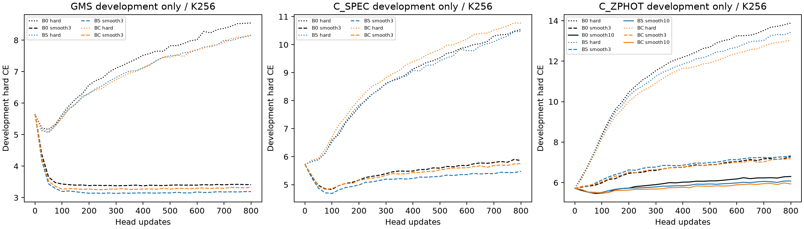

# Paper II — frozen-backbone readout readiness,1029

This is a new frozen-feature/head-only study. It does not initiate Stage2C or inherit a physics-kernel success criterion. Only new prediction heads are optimized.

|Family|Historical labels|Historical input|Historical grid|
|---|---|---|---|
|B0|Foundation model only|No photo-z adapter|No historical photo-z head|
|BS|22,444 DESI/HSC spectroscopic training galaxies|grizy native flux/error+EBV|300 bins0–4.5|
|BC|60,000 CLAUDS ZPHOT training objects|11 median-imputed historical magnitude fields|300 bins0.00500003–5.99249983|

All three use the same current content-hashed Qwen3.5-4B-Base (hidden2560). BS/BC use compatible rank8,alpha16 QLoRA modules. The upstream revision field is null; no revision SHA is invented. Same local base fingerprints, compatible tensor shapes and exact32-object native archived-head replays establish the executable identity. New heads never load historical head weights. Historical magnitude ZP23 is preserved only for native replay; shared main inputs use actual calibrated signed nanomaggies and uncertainties.

|Task|Clean objects|Support pool|Development|Query|Historical-exposure diagnostic|
|---|---:|---:|---:|---:|---:|
|GMS|2304|1024|256|1024|128|
|C_SPEC|1951|927|256|768|17|
|C_ZPHOT|2304|1024|256|1024|128|

GMS uses new downstream roles within original HSC test membership, retaining its historical role separately. This avoids supervised exposure to BS; BS→GMS remains an in-domain catalogue control, while BC→GMS is the cross-survey comparison. C_ZPHOT uses BC historical test identities, excluding known training/validation matches to either adapter. C_SPEC is an explicitly exploratory new split of already inspected Stage3 T2. Its17 BC-trained,5 BC-validation and3 ambiguous objects were removed from the clean1976-object parent, leaving1951 clean objects. Primary support/dev/query galaxies are identical for B0/BS/BC. Exposure diagnostics and uncertain identities are separately saved.

Three support-subset seeds and two fresh-head initialization seeds produce nested K=16,32,64,128,256,512 subsets. K64 andK256 are primary. K counts head gradient-training labels; every learned head/MLP also uses the same256 development labels for checkpoint selection. No query label selects preprocessing, heads, pooling, format or budget. kNN/global controls use K fitted labels and no development-label tuning.

Common primary strings contain actual filter identities, signed flux, positive uncertainty, joint availability, known quality and independently available EBV, ending in the same ordinary PHOTOZ_QUERY marker. No object IDs, redshifts or partition indicators enter strings. All backbones receive the exact same strings within a task/format. Unavailable measurements and EBV stay unavailable. Fixed alternate flat-flux formatting (GMS/C_SPEC) and masked-mean pooling are registered controls at primary budgets. The alternate is not the exact historical BC imputed-magnitude input, so it cannot isolate all historical formatting differences.

Frozen NF4/BF16 inference caches both last and FP32 masked-mean features. Repeated examples, finite values, correct nonpadding positions, no-grad/eval state, adapter reloads and in-memory parameter signatures are checked. Head normalization is fitted on K support objects only. The new32-hidden-unit head, optimizer, labels and batches are identical across backbone arms. Main hard CE and fixed sigma3 neighbor-label controls are separately reported.

See checkpoint_provenance.json, exposure_recovery.json, cohort manifests, protocol.json and protocol_lock.json. No new query evaluation has been used in this readiness assessment.

Source-only addendum: the initial C_ZPHOT pilot selected initialization across all three frozen backbones under hard CE and sigma3. Before query access, a symmetric fixed sigma10 diagnostic was registered for C_ZPHOT; it restores moderateK256 source/development learning while retaining every original condition. No architecture, optimizer, cohort or backbone changed. The original hard readout remains inconclusive for representation ranking where it does not learn. See source_only_sparse_amendment.json and pilot_gate_v1_failed.json.

