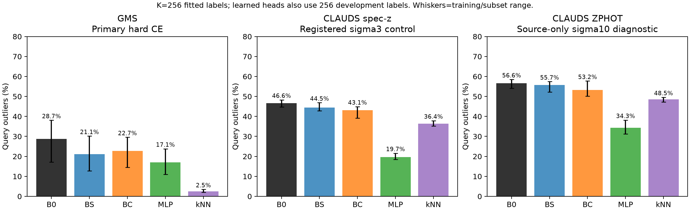
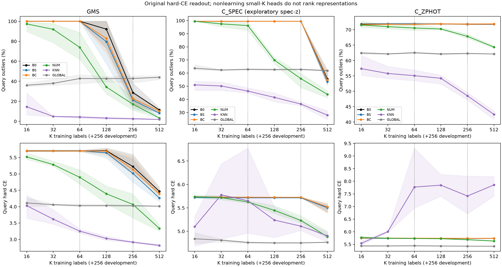
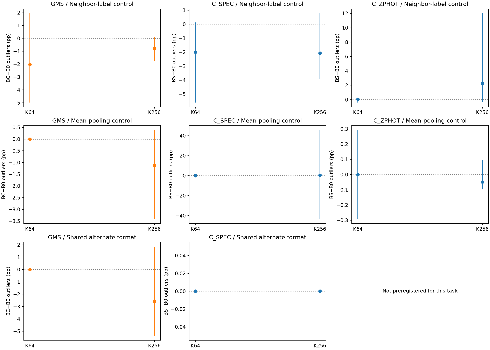
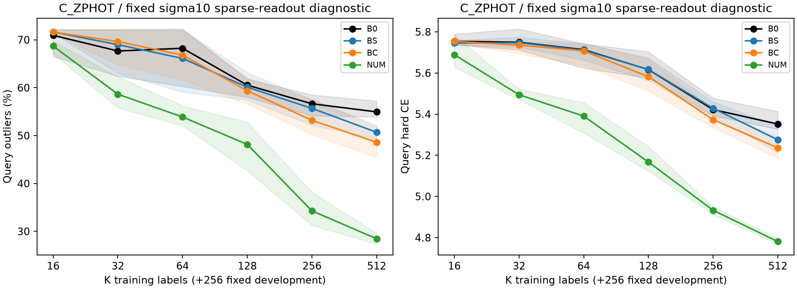

# Paper II — frozen-backbone head-only representation transfer,1029

The answer is conditional: **CLAUDS-posttrained BC supplies transferable GMS representation information under the tested readout, but the study does not establish a practical advantage over inexpensive numerical photo-z controls or a general astrophysical-knowledge benefit.**

At the registered K256 budget, canonical hard-CE GMS outliers are28.68% forB0 and22.67% forBC:−6.01 percentage points, with both outlier and CE improvements in all6 support/head fits (5/6 conditional paired outlier intervals below zero). This is the genuine off-diagonal direction BC→GMS on historically untrained objects. Mean pooling and shared alternate formatting retain a CE advantage in all6 fits, while their mean outlier gains shrink to−1.12pp and−2.60pp. Thus some transfer is visible, with readout/format dependence. The same-budget numerical MLP reaches17.06% outliers and photometric kNN2.54%.

Primary hard-CE frozen-feature heads at K64 do not learn, and CLAUDS hard-label readouts at K256 also largely select initialization. They do not support representation rankings. In the preregistered sigma3 control, BS→C_SPEC at K256 lowers outliers46.57%→44.51% and CE4.917→4.867;5/6 fits improve outliers, but only2/6 conditional outlier intervals exclude zero. The numerical MLP reaches19.68% outliers andCE4.168 under the same sigma3/K/development-label setting. This is a modest exploratory representation gain rather than competitive true-redshift inference. Source-only sigma10 C_ZPHOT results are likewise weak/mixed for BS:56.64%→55.68% outliers, with slightly worse CE; they do not establish stable cross-survey ZPHOT sample-efficiency gains.

K denotes fitted training labels. Every learned readout also uses256 fixed labelled development objects, so K256 is not a256-total-label experiment. All intervals are conditional on a fixed query cohort and a particular support/head fit; different heads on the same galaxy are not independent confirmation.

Only fresh heads were optimized. Qwen bases and historical adapters remain frozen. Primary off-diagonal comparisons use identical clean objects, support subsets, fresh initial weights, input strings, batch indices and query identities. K=64 andK=256 were registered before query access; all six K budgets remain visible.

## Primary off-diagonal results

- BC→GMS versusB0: K256: Δout=-6.01pp (range-13.87..-2.15), ΔCE=-0.088, outlier improvement6/6, CE improvement6/6, all readout learning checks=True; K64: Δout=+0.00pp (range+0.00..+0.00), ΔCE=+0.001, outlier improvement0/6, CE improvement3/6, all readout learning checks=False.
- BS→CLAUDS-SPEC versusB0: K256: Δout=+0.04pp (range+0.00..+0.13), ΔCE=-0.010, outlier improvement0/6, CE improvement6/6, all readout learning checks=False; K64: Δout=+0.04pp (range+0.00..+0.13), ΔCE=-0.010, outlier improvement0/6, CE improvement6/6, all readout learning checks=False.
- BS→CLAUDS-ZPHOT versusB0: K256: Δout=+0.08pp (range+0.00..+0.20), ΔCE=+0.001, outlier improvement0/6, CE improvement3/6, all readout learning checks=False; K64: Δout=+0.07pp (range-0.39..+0.29), ΔCE=+0.000, outlier improvement1/6, CE improvement3/6, all readout learning checks=False.

These are mean differences across3 support-subset seeds×2 head initialization seeds on a fixed query cohort. Ranges describe training/subset variation, not confidence intervals over independent galaxies. Formal1000-replicate paired galaxy intervals for every condition are in paired_representation_bootstrap.json. Repeated heads on the same galaxies are never pooled as independent observations. No stable representation-quality inference is made from heads that fail the source/development learnability check or select initialization.

## Primary endpoint details

|Task/adapter|K|Mean Δoutlier pp|Six-fit range pp|Mean ΔCE|Fits with lower outliers/CE|Paired outlier intervals below0|All heads learned|
|---|---:|---:|---:|---:|---|---:|---|
|C_SPEC/BC|256|-0.02|-0.13..+0.00|+0.000|1/6 / 2/6|0/6|False|
|C_SPEC/BC|64|-0.02|-0.13..+0.00|+0.001|1/6 / 2/6|0/6|False|
|C_SPEC/BS|256|+0.04|+0.00..+0.13|-0.010|0/6 / 6/6|0/6|False|
|C_SPEC/BS|64|+0.04|+0.00..+0.13|-0.010|0/6 / 6/6|0/6|False|
|C_ZPHOT/BC|256|+0.05|-0.10..+0.20|+0.006|3/6 / 0/6|0/6|False|
|C_ZPHOT/BC|64|-0.08|-0.49..+0.20|+0.006|4/6 / 0/6|0/6|False|
|C_ZPHOT/BS|256|+0.08|+0.00..+0.20|+0.001|0/6 / 3/6|0/6|False|
|C_ZPHOT/BS|64|+0.07|-0.39..+0.29|+0.000|1/6 / 3/6|0/6|False|
|GMS/BC|256|-6.01|-13.87..-2.15|-0.088|6/6 / 6/6|5/6|True|
|GMS/BC|64|+0.00|+0.00..+0.00|+0.001|0/6 / 3/6|0/6|False|
|GMS/BS|256|-7.55|-9.38..-4.39|-0.210|6/6 / 6/6|6/6|True|
|GMS/BS|64|+0.00|+0.00..+0.00|+0.008|0/6 / 0/6|0/6|False|

Each learned model uses K gradient-training labels plus256 fixed labelled development objects. This is a fixed-development-cost sample-efficiency curve, not a claim that K is the total target-supervision cost. kNN and affine calibration use K fitted labels with no development-label hyperparameter search; that difference is disclosed.

## Numerical, pooling and formatting controls

Numerical MLP, uncertainty-aware kNN KDE and global affine original-head correction use the same support/query galaxies. Their full curves are shown above and paired primary-budget contrasts are saved in paired_numerical_control_bootstrap.json. A feature advantage overB0 alone is insufficient if simple numeric controls account for the result. Negative transfer, point/PDF disagreements and nonlearning heads remain in the tables.

Whiskers in the control plot show the minimum/maximum difference across six support/head fits. The alternate uses shared native-like flat signed-flux fields, not a different prompt per model. It preserves observations while changing token layout/length. It is not the exact historical BC median-imputed magnitude serialization; native-format-specific effects remain incompletely isolated. Mean pooling uses the same forward pass and hidden dimension, with a newly trained identical head. Smoothing is a fixed sigma3-bin control, never chosen by query accuracy.

## Source-only sparse-readout diagnosis

The original C_ZPHOT K256 pilot selected initialization for every frozen backbone under both hard CE and sigma3 smoothing, despite fitting the training labels. Those main conditions cannot establish a representation ranking. Before any query access, source_only_sparse_amendment.json registered one additional fixed sigma10-bin Gaussian-label diagnostic, applied symmetrically toB0/BS/BC/NUM on C_ZPHOT. All original endpoints, cohorts and models were retained; no backbone, adapter, head architecture or optimizer changed. The wider control improved development CE atK256 by about0.22–0.25 for each backbone and0.78 for NUM. It is a secondary, source-motivated readout remedy, not a retroactively chosen primary endpoint.

## Historical exposure and cohort scope

See readiness_report.md and historical_exposure_summary.json. C_SPEC removes17 prior BC ZPHOT-training objects,5 historical BC validation objects and3 ambiguous matches from the old1976-object T2 parent. Its1951 clean objects are divided into927 support-pool,256 development and768 query galaxies;17 exposed objects remain a separate diagnostic. GMS and C_ZPHOT each have2304 clean objects:1024 support-pool,256 development and1024 query, plus128 exposed diagnostic objects. All primary objects have no identified historical supervised train or validation exposure to either compared adapter. Duplicate IDs and close cross-partition galaxy views are excluded.

Historical source-test membership is retained separately from the new downstream roles. These datasets were already used in historical evaluation, and C_SPEC T2 outcomes were previously inspected in Stage3: none becomes a new untouched confirmation simply by drawing this split. Exposed diagnostics are descriptive and differ in population/selection; they do not identify a causal percentage of improvement explained by memorization. Foundation-model pretraining exposure is unknown.

GMS has little high-z support; the old T2 spectroscopic population is brighter than the full CLAUDS photometric population and contains very few z≥2 objects. The new heads receive whatever sparse target high-z labels happen to enter each K subset; counts are recorded. Conditional redshift, magnitude, SNR, completeness and original HSC-source support metrics are saved. Bright selected spectroscopy cannot establish full faint-CLAUDS accuracy. ZPHOT learning is photometric-reference agreement, not independent redshift truth.

## Historical versus fresh heads

Native BS/BC replay exactly reproduces32 archived validation predictions. The original-head reference table instead applies each frozen historical head to the same canonical cached representation as the fresh-head experiment; it is an explicit format-shift diagnostic. Original BS uses300 bins0–4.5, BC uses300 bins0.00500003–5.99249983. Native-grid CE is not compared across unequal grids; out-of-native-grid objects are counted/excluded from native-PDF summaries. K0 original-head references are not connected to K>0 fresh-head learning curves. Fresh heads never inherit historical head weights.

## Twelve requested scientific answers

1. **BS→CLAUDS versus B0:** K256: Δout=+0.04pp (range+0.00..+0.13), ΔCE=-0.010, outlier improvement0/6, CE improvement6/6, all readout learning checks=False; K64: Δout=+0.04pp (range+0.00..+0.13), ΔCE=-0.010, outlier improvement0/6, CE improvement6/6, all readout learning checks=False. This tests target-supervised readout of frozen representations; it is not zero-shot transfer.
2. **BC→GMS versus B0:** K256: Δout=-6.01pp (range-13.87..-2.15), ΔCE=-0.088, outlier improvement6/6, CE improvement6/6, all readout learning checks=True; K64: Δout=+0.00pp (range+0.00..+0.00), ΔCE=+0.001, outlier improvement0/6, CE improvement3/6, all readout learning checks=False. BS→GMS is an in-domain control, not the main cross-survey evidence.
3. **Small-budget efficiency:** assess registered K64/K256 jointly with all six-budget curves and fixed256-label development cost. Largest observed gains elsewhere are secondary. relative_sample_efficiency.json uses predeclared10–50% outlier thresholds and conservative six-fit learning/galaxy-CI conditions; unresolved thresholds are reported as null.
4. **Stability:** paired_summary.csv separates support-subset and initialization variation; pooling/format/smoothing controls above test readout dependence. Each task has one fixed query split; this does not establish stability over independently redrawn query cohorts.
5. **Prior exposure:** known training, validation and ambiguous matches are excluded from every primary support/dev/query cohort. Separate exposed diagnostics show conditional differences, not a causal decomposition of memorization. Unknown foundation pretraining exposure is not ruled out.
6. **Representation versus original head:** new heads start identically and only cached hidden states differ. Any reproducible off-diagonal gain after readout learning supports transferable representations under this protocol, even if an old head fails. Original-head reuse is separately labelled and never initializes new heads.
7. **Numerical controls:** no practical numerical-control advantage is established. At GMS K256 hard CE, BC outliers22.67% exceed MLP17.06% andkNN2.54%. With sigma3, BC4.48% exceeds MLP2.29% andkNN2.54%. C_SPEC sigma3 BS44.51% exceeds MLP19.68%; C_ZPHOT sigma10 BS55.68% exceeds MLP34.28%. Point and PDF metrics are both retained, and global-affine controls are separately tabulated. The primary representation improvement overB0 remains a narrower finding.
8. **Serialization:** GMS/C_SPEC shared alternate tests provide bounded evidence; no exact per-backbone source-native prompt is used in the main comparison. Effects of layout, length, terminal-token readout and historical BC imputation remain possible explanations.
9. **ZPHOT versus spectroscopy:** K256: Δout=+0.08pp (range+0.00..+0.20), ΔCE=+0.001, outlier improvement0/6, CE improvement3/6, all readout learning checks=False; K64: Δout=+0.07pp (range-0.39..+0.29), ΔCE=+0.000, outlier improvement1/6, CE improvement3/6, all readout learning checks=False for the original hard ZPHOT readout, versus K256: Δout=+0.04pp (range+0.00..+0.13), ΔCE=-0.010, outlier improvement0/6, CE improvement6/6, all readout learning checks=False; K64: Δout=+0.04pp (range+0.00..+0.13), ΔCE=-0.010, outlier improvement0/6, CE improvement6/6, all readout learning checks=False for exploratory spectroscopy. Nonlearning hard readouts do not establish a label-type transfer effect; the fixed smoothing controls remain separate. Different populations and label mechanisms prevent a clean causal comparison.
10. **Future few-shot prompting/calibration:** BC→GMS provides a reason to retain a small frozen-feature calibration branch, but no result proves in-context prompting ability. The dominant low-K300-class readout failure and stronger raw-photometry controls favor testing a simpler continuous/density readout before expensive backbone posttraining.
11. **Next Paper II models/cohorts:** retain B0 as the essential control and BC for the observed BC→GMS representation effect. BS→C_SPEC is a smaller exploratory candidate; keep numerical MLP/kNN as mandatory practical baselines. Reuse the saved clean IDs only with their inspected/exploratory status preserved, and reserve new independent spectroscopy for confirmation. No deployment winner or additional backbone-training run is selected here.
12. **Astrophysical-knowledge claim:** require representative independent high-z/faint truth, robust input/readout tests, matched source-label/optimization histories, learned-versus-random/shuffled-label adapter controls and evidence separating generic numeric/text features from physical behavior. This historical-checkpoint readout study alone cannot establish that stronger claim.

## Reproduction and integrity

Protocol/cohort/input/feature hashes, native replay, no-grad/eval checks, in-memory parameter signatures, head initialization hashes, K-only normalizers, selection locks, per-galaxy PDFs/PIT, paired intervals and runtime/cache costs are stored here. Source/development selection finishes before query_labels_opened.json. No base, LoRA or DoRA parameter is optimized; no Stage2C or physics-kernel experiment is launched. Verification and full manifests accompany the completed report.
