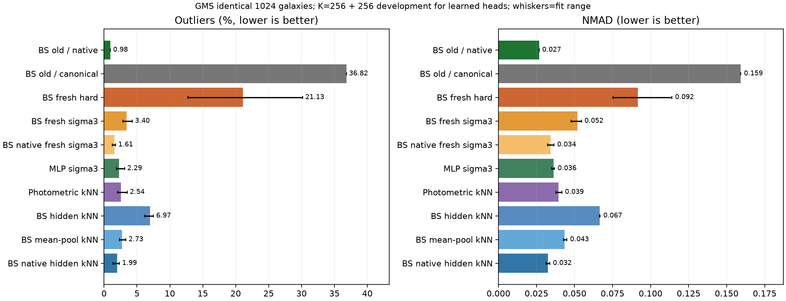
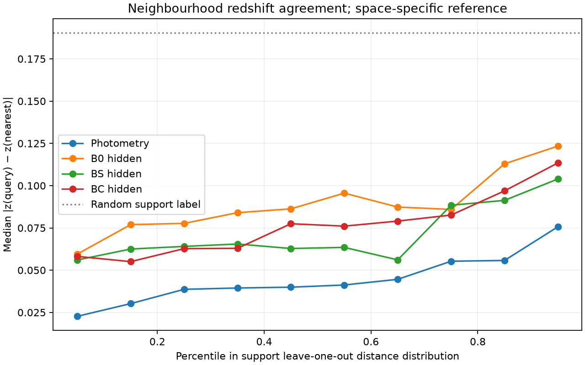
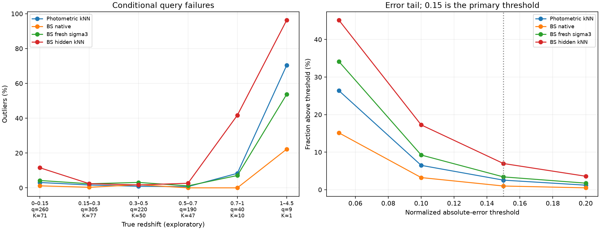
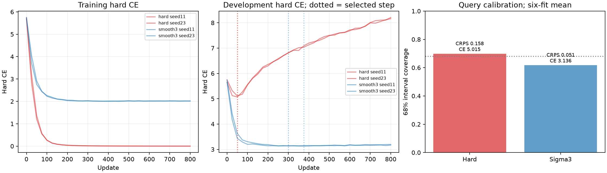

# Paper II Stage 4.5 — native head, sparse readout and kNN diagnostic

## Status and scope

Completed retrospectively on the exact Stage 4 GMS query cohort (1,024 galaxies). Stage 4 query results were already inspected before this follow-up was designed: it is exploratory, not a new independent test. The same three nested K=256 subsets and six subset/head-seed combinations were used throughout. K=256 means **256 gradient-training labels plus 256 fixed development labels** for learned heads; kNN and constants use 256 support labels and no development labels. Historical BS previously trained on 22,444 spectroscopic galaxies; “0 additional labels” does not mean it had no prior supervision.

## Matched-cohort results

| Configuration | Additional training labels | Development labels | Outliers | NMAD | CE | CRPS | 68% coverage |
|---|---:|---:|---:|---:|---:|---:|---:|
| BS historical / native | 0 | 0 | 0.98% | 0.0267 | 2.497 | 0.0287 | 0.720 |
| BS historical / canonical | 0 | 0 | 36.82% | 0.1593 | 6.554 | 0.1751 | 0.235 |
| BS fresh / canonical / hard | 256 | 256 | 21.13% | 0.0916 | 5.015 | 0.1575 | 0.698 |
| BS fresh / canonical / sigma3 | 256 | 256 | 3.40% | 0.0519 | 3.136 | 0.0508 | 0.617 |
| BS fresh / native / sigma3 | 256 | 256 | 1.61% | 0.0343 | 2.766 | 0.0360 | 0.733 |
| B0 fresh / canonical / sigma3 | 256 | 256 | 5.26% | 0.0601 | 3.343 | 0.0613 | 0.584 |
| BC fresh / canonical / sigma3 | 256 | 256 | 4.48% | 0.0561 | 3.234 | 0.0584 | 0.606 |
| Numerical MLP / sigma3 | 256 | 256 | 2.29% | 0.0362 | 2.904 | 0.0395 | 0.833 |
| Engineered photometry kNN | 256 | 0 | 2.54% | 0.0394 | 2.915 | 0.0392 | 0.758 |
| BS last-token hidden kNN | 256 | 0 | 6.97% | 0.0666 | 3.527 | 0.0629 | 0.740 |
| B0 last-token hidden kNN | 256 | 0 | 13.15% | 0.0890 | 3.907 | 0.0801 | 0.711 |
| BC last-token hidden kNN | 256 | 0 | 8.53% | 0.0724 | 3.503 | 0.0663 | 0.730 |
| BS mean-pooling hidden kNN | 256 | 0 | 2.73% | 0.0434 | 3.024 | 0.0413 | 0.746 |
| BS native-input hidden kNN | 256 | 0 | 1.99% | 0.0324 | 2.788 | 0.0349 | 0.799 |
| constant_median | 256 | 0 | 34.44% | 0.1708 | — | — | — |
| constant_mean | 256 | 0 | 40.07% | 0.1802 | — | — | — |

The table shows means over six fits for learned heads and three subsets for kNN. Native historical models are a single fixed prediction. Fit ranges and per-fit records are in [integrated_summary.csv](integrated_summary.csv) and [integrated_model_metrics.csv](integrated_model_metrics.csv). Historical and Stage 4 BS grids are both 300 bins from 0 to 4.5; CE here uses bin masses on that common grid. The constant point predictors have no PDF.

## Ten requested answers

1. **Original native BS:** the matched historical test predictions give 0.98% outliers, NMAD 0.0267, CE 2.497, CRPS 0.0287, and 72.0% nominal 68% coverage. All 1,024 IDs and labels align with the Stage 4 query. Thirty-two query examples were freshly replayed bit-exactly, in addition to the historical validation replay. The full 1,024 prediction set is archived inference, not a claim that all 1,024 were newly rerun.
2. **Serialization:** the same historical head on canonical cached hidden states has 36.82% outliers. Native minus canonical is -35.84 pp (paired galaxy 95% CI -38.96 to -33.10 pp). This is a large effect of the *whole input interface*, including token order, precision and final marker; it does not isolate an individual string component. Historical head architecture/training cannot be equated with a fresh small head.
3. **Sparse readout:** BS hard→sigma3 changes 21.13% to 3.40%; paired sigma3 minus hard is -17.72 pp (paired galaxy 95% CI -19.11 to -16.28 pp). B0 and the numerical MLP improve too; soft targets fix a general sparse-classification problem. Native features with a fresh sigma3 head give 1.61%, versus 3.40% on canonical features; paired native minus canonical is -1.79 pp (paired galaxy 95% CI -2.54 to -1.17 pp). Against the photometric kNN, the native fresh head has difference -0.93 pp (paired galaxy 95% CI -1.58 to -0.37 pp). That 2×2 cross does not identify a unique causal percentage because historical head capacity and prior training differ. The six native heads selected updates 175–450.
4. **BS hidden kNN versus fresh BS:** fixed uniform-k10 last-token Euclidean BS hidden kNN gives 6.97%, versus 3.40% for the fresh soft head. A negative conclusion is confined to this fixed neighbour metric. The already cached mean-pooled BS feature produces 2.73%, illustrating that token aggregation affects local geometry. Native-input BS hidden kNN is 1.99% under the same uniform Euclidean protocol, compared with 6.97% for canonical input. Passing native features through the frozen, historically supervised BS head's penultimate layer gives 1.33%; its canonical counterpart gives 23.24%. These head-derived vectors inherit prior spec-z supervision and are not pure backbone features.
5. **BS versus B0 neighbourhoods:** last-token BS versus B0 Euclidean is 6.97% versus 13.15%; BS minus B0 is -6.18 pp (paired galaxy 95% CI -7.52 to -4.91 pp). Centered-cosine results are 8.40% versus 16.86%. Mean-pool differences are reported separately. The same query and matching support subsets are used; this is an in-domain, conditional geometry comparison.
6. **Why photometric kNN is strong:** the exact engineered feature kNN reproduces 2.54%; constant median gives 34.44%, and permuting support-feature/redshift pairs gives mean 37.98% (60 permutations over three subsets). Query redshifts are concentrated at median 0.269 and 5th–95th percentiles 0.078–0.696, but the constants and shuffle show that object-specific photometric association contributes. Shape/mask alone gives 4.49%, apparent brightness alone 7.10%, together 3.45%, and adding relative errors 2.80%. Measurement/selection-only features give 17.64%. These are predictive ablations, not causal fractions.
7. **Integrity:** all three original kNN PDFs reproduce the saved values within 0; changing query labels and permuting query order leaves predictions invariant. No shared object/group identity, no support–query pair within 2 arcsec (minimum 30.03 arcsec), and no known BS/BC historical train/validation match or ambiguous exposure were found. Traceable input fields are measured flux/error, masks, quality, EBV and brightness; no target-redshift proxy enters the implemented features. This is “no identified leakage,” not proof of complete absence or foundation-pretraining isolation.
8. **What explains the old comparison:** large native/canonical and hard/sigma3 effects, plus shape/brightness signal and differences among distance/pooling choices, all have direct support. Their interactions and historical supervision prevent attributing an additive fraction of the BS–kNN discrepancy to each. Existing soft MLP is 2.29% versus kNN 2.54%; MLP minus kNN is -0.24 pp (paired galaxy 95% CI -0.90 to +0.33 pp). The paired interval, not the ranking of means, should guide interpretation.
9. **BC→GMS:** the original hard-head BC−B0 paired comparison remains interpretable under that predeclared readout, provided known audit limits are stated. Under sigma3, BC−B0 is -0.78 pp (paired galaxy 95% CI -1.45 to -0.11 pp); original Stage 4 reports six of six paired CE intervals below zero, but only one of six outlier intervals. It is a readout/metric-dependent conditional transfer signal, not superiority to simple numerical models. No new independent external generalisation is established.
10. **Minimum next CLAUDS experiment:** lock one serialization/readout and strong numeric baselines *before* accessing an independent, previously unexamined CLAUDS spectroscopic cohort; audit prior identity exposure, measure matched K + development supervision, and evaluate the same objects with paired intervals. Explicitly characterize magnitude/redshift selection. A bright spectroscopic subset does not validate the whole faint CLAUDS population.

## Neighbourhoods, selection and robustness

The original kNN uses support-only coordinate standardization, k=10, inverse-distance weights and a fixed Gaussian redshift KDE. It is **engineered photometric-feature kNN**, not a bare colour or raw-flux distance. The uniform-weight comparison applies the same K-only transforms and KDE to photometry and all hidden feature spaces. Last-token cosine uses K-centered unit vectors; Euclidean uses K-standardized coordinates without L2 normalization. No k, loss width or distance was picked using the new query results. Mean pooling and historical-head latent vectors are named sensitivity controls; the latter contains prior supervised training and is not a pure backbone representation.

Original weighted kNN nearest-neighbour distance median 0.9624; nearest angular separation median 161404.8 arcsec; median |Δz| 0.0416; |Δz|<0.05 fraction 58.3%; median effective neighbour count 9.79. Details, including all neighbour IDs, distances and labels for each query, are in [neighbourhood_diagnostics.csv](neighbourhood_diagnostics.csv). Conditional outliers versus distance and apparent i magnitude are in [original_knn_conditioned_metrics.csv](original_knn_conditioned_metrics.csv); explicit nearest photometric/positional differences are in [nearest_neighbour_photometric_differences.csv](nearest_neighbour_photometric_differences.csv).

Redshift-stratified query counts are [260, 305, 220, 190, 40, 9] across the figure bins; the upper tail is small. A single catastrophic-outlier threshold can hide different error tails. The raw conditionals and counts are in [conditional_redshift_metrics.csv](conditional_redshift_metrics.csv), original BS training and support/query counts are in [redshift_source_support_counts.csv](redshift_source_support_counts.csv), the distributions are in [redshift_distribution.png](redshift_distribution.png), and the pre-fixed threshold curves in [error_threshold_tail.csv](error_threshold_tail.csv).

The histories plot hard CE for both training conditions, matching the saved Stage 4 checkpoints. The sigma3 training target was centered on the **integer true-redshift bin**, and checkpoint selection used development hard CE. No unrecorded soft-training-loss curves are invented.

## Hypothesis assessment

| Hypothesis | Assessment | Evidence and limitation |
|---|---|---|
| Historical native head retains useful prediction | Supported | 0.98% matched-cohort outliers; trained with substantial prior labels. |
| Native-to-canonical interface shift | Supported for this entire interface change | Same old head: 0.98%→36.82%; individual token/field causes remain unresolved. |
| Sparse hard-classifier readout | Supported | BS hard→sigma3 21.13%→3.40%; improvement also appears in B0 and NUM. |
| Hidden-neighbourhood geometry | Partially supported and metric-dependent | Last-token BS Euclidean 6.97%; mean-pool 2.73%; these do not measure all recoverable information. |
| Query redshift concentration alone | Not sufficient | Constants 34.44%; shuffled mean 37.98% versus original 2.54%. |
| Engineered photometric features help | Supported as predictive association | Shape/brightness/error ablations and shuffle; population selection remains a limitation. |
| Identity/feature leakage | No leakage identified within audited sources | Exact/positional/label perturbation audits pass; unknown foundation pretraining and undetected catalogue issues remain. |

## Statistical accounting and provenance

[paired_comparisons.csv](paired_comparisons.csv) uses 1,000 galaxy bootstrap draws with the same sampled query indices across all fixed fits, averaging matched subset/initialization differences within each draw. Repeated predictions of the same galaxy are not treated as independent samples. Fit minima/maxima are descriptive training/subset ranges, not galaxy confidence intervals. For outlier comparisons the table also records both-wrong and discordant counts. A few hard/fresh heads are correlated because support subsets overlap; no inference treats them as six independent cohorts.

Check A uses a full archived test prediction matched by persistent IDs, a newly evaluated exact 32-query replay, and frozen native features for all 2,304 clean objects. Check B replays all 48 existing GMS hard/sigma3 PDFs with maximum absolute discrepancy 0. Check C uses saved no-grad canonical/mean representations and the new native cache. Check D reproduces the fixed original kNN, audits identities and exposures, runs constants, feature ablations and pre-fixed label permutations. See [checkpoint replay](checkpoint_replay_and_native_head.md), [kNN integrity audit](knn_leakage_and_features_audit.md), [protocol.json](protocol.json), and [reproduction commands](commands_executed.sh). No backbone, adapter or historical head was trained or modified; six new native-input heads are the only new gradient fits. No Stage 2C was launched.
